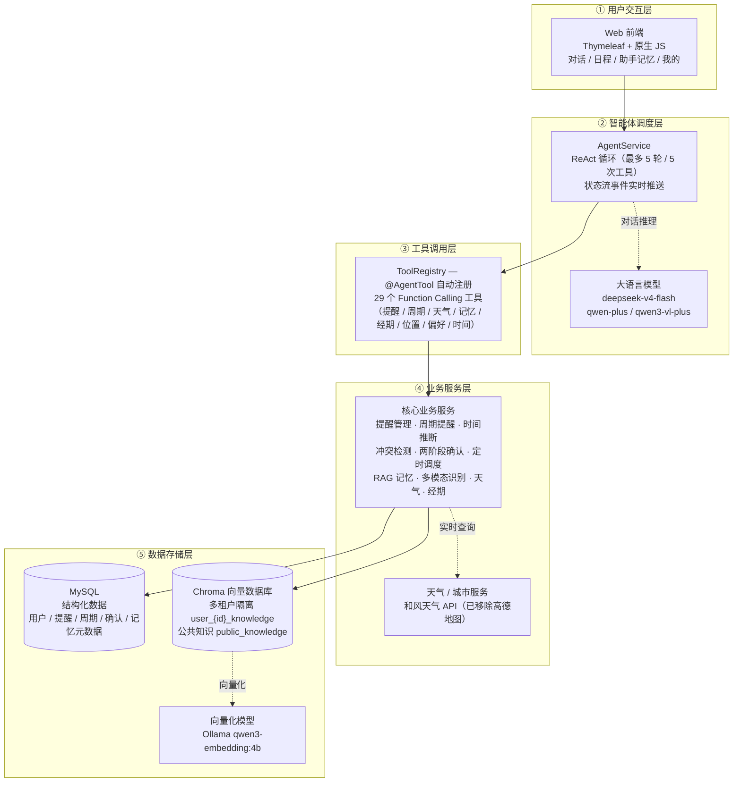

# 校园生活提醒助手 (Life Reminder)

> 基于 Agent 的智能化校园生活提醒系统，支持自然语言创建提醒、课表智能导入、天气查询、经期管理等功能。

---

## 1. 项目概述

### 1.1 项目定位

校园生活智能提醒助手是一款面向大学生群体的 AI 驱动智能提醒应用。用户可通过自然语言与 AI 助手对话，快速创建日程提醒、查询天气、管理课表、记录经期等。

### 1.2 核心功能

| 功能模块 | 说明 |
|---------|------|
| **AI 对话提醒** | 基于 ReAct 模式的 Agent，支持自然语言创建（含批量一句话多事务）、查询、修改、取消提醒 |
| **Agent 状态流可视化** | 每一步思考/工具调用通过事件+WebSocket 实时推送到前端，以带 emoji 的步骤条展示进度 |
| **课表智能导入** | 支持 Excel / PDF / 图片上传，通义千问多模态识别课表结构并批量生成提醒 |
| **天气查询** | 实时天气、天气预报、空气质量、天气预警查询（对接和风天气 API，城市搜索+AI 消歧义+错别字纠正） |
| **天气联动提醒** | 定时推送提醒时按城市查询天气，结合话术模板生成穿衣/带伞等天气建议 |
| **经期管理** | 经期追踪、状态预测、周期参数维护、经期状态确认卡片、经期提醒自动生成 |
| **个人记忆系统 (RAG)** | 基于 ChromaDB + Ollama 的向量知识库，AI 对话中自动提取事实存储，11 类记忆分类与标题由 AI 生成，用户可写备注；记忆库页面支持分类筛选、批量删除、导出，WebSocket 实时同步；另含公共使用手册库 |
| **周期提醒** | 支持按日/周/月重复的周期性提醒，每日自动生成实例，实例与实际提醒 1:1 对应 |
| **日历视图** | 可视化月/周/日日历展示，支持农历日期与节日显示、日期跳转（1900-3000 年） |
| **实时推送** | 基于 Spring WebSocket（STOMP/SockJS）的卡片式提醒推送、交互确认、Agent 状态流消息 |
| **冲突检测** | 创建提醒时自动检测时间冲突，支持覆盖/跳过策略，冲突详情结构化返回 |
| **两阶段确认** | 提醒创建→信息确认→到点执行确认的两阶段流程，含重试次数、超时默认、编辑重解析 |
| **用户偏好管理** | 默认城市、默认提前提醒分钟、确认间隔、经期参数等，Agent 可直接读写 |
| **课表批量导入管理** | 文件解析→AI 识别→批量确认卡片→逐条创建，记录导入任务与明细表 |
| **对话历史与统计** | 每轮对话按 sessionId 落库 user_dialog_stats，支持历史消息回显与意图分类统计 |

### 1.3 适用场景

- 大学生日常日程管理
- 课程表批量导入与提醒生成
- 考试、作业、截止日期提醒
- 天气敏感场景查询（出行前查看天气、穿衣建议等）
- 经期追踪与健康管理
- 个人知识管理与记忆存储

---

## 2. 技术栈

### 2.1 后端框架

| 技术 | 版本 | 说明 |
|-----|------|-----|
| Spring Boot | 3.4.1 | 核心框架 |
| Spring AI | 1.1.4 | AI 能力集成 |
| JDK | 21 | Java 运行环境 |

### 2.2 数据库与 ORM

| 技术 | 版本 | 说明 |
|-----|------|-----|
| MySQL | 8.0+ | 关系型数据库 |
| Spring Data JPA | (Boot 管理) | ORM 框架 |
| Hibernate | (Boot 管理) | JPA 实现 |

### 2.3 AI 与大模型

| 技术 | 版本 | 说明 |
|-----|------|-----|
| DeepSeek-V4-Flash | — | 主对话模型（ReAct Agent + 工具调用） |
| 通义千问 | — | 识别模型：文本用 qwen-plus，图片用 qwen3-vl-plus |
| Ollama | 0.32.5 | 本地 Embedding 模型运行时 |
| qwen3-embedding:4b | — | 文本向量嵌入模型 |
| ChromaDB | 1.5.9 | 向量数据库（RAG 知识库） |
| DashScope SDK | 2.23.2 | 阿里通义千问官方 SDK |

### 2.4 实时通信与安全

| 技术 | 版本 | 说明 |
|-----|------|-----|
| Spring WebSocket | (Boot 管理) | 实时消息推送 |
| Spring Security | (Boot 管理) | BCrypt 密码加密 |

### 2.5 前端与模板

| 技术 | 版本 | 说明 |
|-----|------|-----|
| Thymeleaf | (Boot 管理) | 服务端模板引擎 |
| 原生 HTML/CSS/JS | — | 前端页面 |
| SockJS / STOMP.js | — | WebSocket 客户端 |

### 2.6 文档解析与工具

| 技术 | 版本 | 说明 |
|-----|------|-----|
| Apache POI | 5.3.0 | Excel 文件解析 |
| PDFBox | 3.0.3 | PDF 文件解析 |
| Lombok | 1.18.46 | 代码简化 |
| Apache Commons Lang3 | (Boot 管理) | 通用工具库 |
| lunar | 1.7.7 | 农历/节日计算 |

---

## 3. 环境准备

### 3.1 必备环境

| 环境 | 版本要求 | 说明 |
|-----|---------|-----|
| JDK | 21+ | 推荐使用 JDK 21 |
| Maven | 3.8+ | 项目构建工具（或使用自带的 `mvnw`） |
| MySQL | 8.0+ | 关系型数据库 |
| Chrome / Edge | 最新版 | 推荐浏览器 |

### 3.2 外部服务

| 服务 | 版本要求 | 说明 |
|-----|---------|-----|
| Ollama | 0.32.5 | 本地运行 Embedding 模型 |
| ChromaDB | 1.5.9 | 向量数据库 |

### 3.3 Ollama 模型

需在本地 Ollama 中安装以下模型：

```bash
ollama pull qwen3-embedding:4b
```

### 3.4 ChromaDB 安装

```bash
# 使用 pip 安装
pip install chromadb

# 启动 ChromaDB 服务（绑定所有网卡）
chroma run --host 0.0.0.0 --port 8000
```

### 3.5 字体文件

项目使用以下自定义字体（需放在 `src/main/resources/static/fonts/` 目录下）：
- `MaoKenShiJinHei-2.ttf`（猫啃什锦黑）
- `MaoKenZhuYuanTi-MaokenZhuyuanTi-2.ttf`（猫啃筑圆体）

---

## 4. 配置说明

### 4.1 `application.yml` 关键配置

项目配置文件位于 `src/main/resources/application.yml`：

```yaml
server:
  port: 8083

spring:
  datasource:
    url: jdbc:mysql://localhost:3307/reminder?useSSL=false&serverTimezone=Asia/Shanghai&characterEncoding=UTF-8&allowPublicKeyRetrieval=true
    username: root
    password: password
    driver-class-name: com.mysql.cj.jdbc.Driver
    hikari:
      maximum-pool-size: 10
      minimum-idle: 5
      connection-timeout: 30000

  jpa:
    database-platform: org.hibernate.dialect.MySQLDialect
    hibernate:
      ddl-auto: update
    show-sql: false
    properties:
      hibernate:
        format_sql: false
        use_sql_comments: false
        jdbc:
          batch_size: 20

  jackson:
    time-zone: Asia/Shanghai
    date-format: yyyy-MM-dd HH:mm:ss

  servlet:
    multipart:
      max-file-size: 5MB
      max-request-size: 10MB

  thymeleaf:
    cache: false
    encoding: UTF-8
    mode: HTML

  ai:
    openai:
      api-key: ${DEEPSEEK_API_KEY:your-deepseek-api-key}
      base-url: https://api.deepseek.com
      chat:
        options:
          model: deepseek-v4-flash
          temperature: 0.3
          max-tokens: 4096

    # Chroma向量数据库配置
    vectorstore:
      chroma:
        client:
          host: http://localhost
          port: 8000
        tenant-name: default_tenant
        database-name: default_database
        collection-name: public_knowledge
        initialize-schema: true

    # Ollama配置（用于Embedding）
    ollama:
      base-url: http://localhost:11434
      embedding:
        options:
          model: qwen3-embedding:4b

weather:
  api:
    key: ${WEATHER_API_KEY:your-weather-api-key}
    host: ${WEATHER_API_HOST:https://your-weather-api-host}
    connect-timeout: 10000
    read-timeout: 10000

logging:
  level:
    com.dormrepair.remindme: DEBUG
    org.hibernate.SQL: WARN

agent:
  enabled: true  # Agent 开关，设为 false 时回退到原有逻辑
  max-history: 10  # 最多保留的对话历史条数
  timeout-seconds: 15  # Agent 处理超时时间

dashscope:
  api:
    key: ${DASHSCOPE_API_KEY:your-dashscope-api-key}
```

### 4.2 配置项说明

#### 数据库配置

| 配置项 | 说明 | 是否必填 |
|-------|------|---------|
| `spring.datasource.url` | MySQL 连接 URL（默认端口 3307） | 是 |
| `spring.datasource.username` | 数据库用户名 | 是 |
| `spring.datasource.password` | 数据库密码 | 是 |
| `spring.jpa.hibernate.ddl-auto` | DDL 策略，`update` 自动更新表结构 | 是 |

#### AI 配置

| 配置项 | 说明 | 是否必填 |
|-------|------|---------|
| `spring.ai.openai.api-key` | DeepSeek API Key | 是 |
| `spring.ai.openai.base-url` | DeepSeek API 地址 | 是 |
| `spring.ai.openai.chat.options.model` | 使用的模型名称 | 是 |
| `spring.ai.vectorstore.chroma.client.host` | ChromaDB 地址 | 是 |
| `spring.ai.vectorstore.chroma.client.port` | ChromaDB 端口 | 是 |
| `spring.ai.ollama.base-url` | Ollama 服务地址 | 是 |
| `spring.ai.ollama.embedding.options.model` | Embedding 模型名称 | 是 |

> DeepSeek 请求超时：连接 10 秒、读取 30 秒；并通过 `extra-body.thinking.type: disabled` 关闭思考模式。

#### 外部服务配置

| 配置项 | 说明 | 是否必填 |
|-------|------|---------|
| `weather.api.key` | 和风天气 API Key | 否 |
| `weather.api.host` | 和风天气 API 主机地址 | 否 |
| `weather.api.connect-timeout` | 天气 API 连接超时（毫秒），默认 10000 | 否 |
| `weather.api.read-timeout` | 天气 API 读取超时（毫秒），默认 10000 | 否 |
| `dashscope.api.key` | 通义千问 API Key（文本/图片识别需要时配置） | 否 |
| `agent.enabled` | Agent 模式开关，true 走 ReAct Agent 模式，false 回退传统 LLM 解析卡片 | 是 |
| `agent.max-history` | 每用户会话历史上限（超 30 分钟未访问自动清理） | 是 |
| `agent.timeout-seconds` | Agent 单次请求超时秒数 | 是 |

---

## 5. 环境变量与外部服务配置

### 5.1 环境变量列表

| 环境变量 | 对应配置项 | 用途 | 获取方式 |
|---------|----------|------|---------|
| `DEEPSEEK_API_KEY` | `spring.ai.openai.api-key` | 主对话 AI 模型（Agent 核心） | [https://platform.deepseek.com](https://platform.deepseek.com) 注册后获取 |
| `WEATHER_API_KEY` | `weather.api.key` | 和风天气 API Key | [https://dev.qweather.com](https://dev.qweather.com) 申请 |
| `WEATHER_API_HOST` | `weather.api.host` | 和风天气 API 主机地址 | 与 Weather API Key 同源 |
| `DASHSCOPE_API_KEY` | `dashscope.api.key` | 通义千问文本/图片识别（课表、日程） | [https://dashscope.console.aliyun.com](https://dashscope.console.aliyun.com) 开通服务后获取 |

> **说明**：城市搜索/地理编码已接入 LLM + 和风天气城市搜索接口（LocationService），不再需要独立的高德 Key。以上变量均有默认值兜底，不配也能启动（对应功能不可用）。如需完整功能，请配置对应变量。

### 5.2 设置环境变量

#### Windows (PowerShell)

```powershell
# 临时设置（当前会话有效，启动前执行），输入真实的api key/api host
$env:DEEPSEEK_API_KEY = "your-deepseek-api-key"
$env:WEATHER_API_KEY = "your-weather-api-key"
$env:WEATHER_API_HOST = "https://your-weather-api-host"
$env:DASHSCOPE_API_KEY = "your-dashscope-api-key"

# 启动项目
.\mvnw.cmd spring-boot:run
```

#### macOS / Linux (bash)

```bash
export DEEPSEEK_API_KEY="your-deepseek-api-key"
export WEATHER_API_KEY="your-weather-api-key"
export WEATHER_API_HOST="https://your-weather-api-host"
export DASHSCOPE_API_KEY="your-dashscope-api-key"

./mvnw spring-boot:run
```

#### 启动时通过 JVM 参数传递

```bash
java -jar target/life-reminder-0.0.1-SNAPSHOT.jar \
  -DDEEPSEEK_API_KEY=your-deepseek-api-key \
  -DWEATHER_API_KEY=your-weather-api-key \
  -DWEATHER_API_HOST=https://your-weather-api-host \
  -DDASHSCOPE_API_KEY=your-dashscope-api-key
```

---

## 6. 数据库说明

### 6.1 创建数据库

```sql
CREATE DATABASE IF NOT EXISTS reminder
  DEFAULT CHARACTER SET utf8mb4
  DEFAULT COLLATE utf8mb4_unicode_ci;
```

### 6.2 数据库表结构

JPA 配置为 `ddl-auto: update`，首次启动时自动创建以下 11 张表：

| 表名 | 说明 |
|------|------|
| `users` | 用户表：账号信息、偏好设置、经期参数等等 |
| `reminders` | 提醒表：所有用户提醒，支持单点和时间段，含确认状态、执行状态 |
| `push_logs` | 推送日志表：记录每一次推送动作 |
| `confirmation_sessions` | 确认会话表：提醒创建两阶段确认流程的会话管理（含 stage、尝试次数、parsed 结构化字段等） |
| `verification_codes` | 验证码表：手机验证码存储与校验（模拟验证码，前端弹窗展示） |
| `user_dialog_stats` | 对话记录表：按 sessionId 保存用户/助手消息，用于历史回显与意图统计 |
| `schedule_imports` | 课表导入表：文件导入任务记录 |
| `schedule_import_items` | 课表导入明细表：每一条待创建提醒 |
| `recurring_reminders` | 周期提醒模板表：按日/周/月重复规则 |
| `recurring_instances` | 周期提醒实例表：模板生成的每日实例 |
| `agent_status_flows` | Agent 状态流表：flowId、最终状态、总步数、耗时与步骤 JSON，用于刷新后回放 |

### 6.3 表关系图

```
users ──1:N──> reminders
users ──1:N──> confirmation_sessions
users ──1:N──> user_dialog_stats
users ──1:N──> schedule_imports
users ──1:N──> recurring_reminders
users ──1:N──> agent_status_flows

schedule_imports ──1:N──> schedule_import_items
recurring_reminders ──1:N──> recurring_instances
recurring_instances ──1:1──> reminders (实例对应实际提醒)
confirmation_sessions ──1:1──> reminders (确认后回填)
reminders ──1:N──> push_logs
```

### 6.4 完整建表 SQL

如需手动建表，参考 `sql（数据库脚本）/reminder-仅结构.sql`。

---

## 7. 启动步骤

### 7.1 前置条件

1. **MySQL**：确保 MySQL 服务已启动，已创建 `reminder` 数据库
2. **Ollama**：已安装并运行，已拉取 `qwen3-embedding:4b` 模型
3. **ChromaDB**：已安装并运行（`chroma run --host 0.0.0.0 --port 8000`）
4. **字体**：`MaoKenShiJinHei-2.ttf` 和 `MaoKenZhuYuanTi-MaokenZhuyuanTi-2.ttf` 放在 `src/main/resources/static/fonts/` 下

### 7.2 配置数据库连接

修改 `src/main/resources/application.yml` 中的数据库配置（当前配置为端口 3307、密码 `password`；若本地 MySQL 使用 3306 或其他密码，请按实际调整）：

```yaml
spring:
  datasource:
    url: jdbc:mysql://localhost:3307/reminder?useSSL=false&serverTimezone=Asia/Shanghai&characterEncoding=UTF-8&allowPublicKeyRetrieval=true
    username: root
    password: your-password
```

### 7.3 设置环境变量

至少需要设置以下必填项（Agent 功能必需）：

```powershell
# Windows PowerShell
$env:DEEPSEEK_API_KEY = "your-deepseek-api-key"
```

如需完整功能，额外配置：

```powershell
$env:WEATHER_API_KEY = "your-weather-api-key"
$env:WEATHER_API_HOST = "https://your-weather-api-host"
$env:DASHSCOPE_API_KEY = "your-dashscope-api-key"
```

### 7.4 启动外部依赖服务

```bash
# 1. 启动 Ollama
ollama serve  # 默认端口 11434

# 2. 启动 ChromaDB
chroma run --host 0.0.0.0 --port 8000
```

### 7.5 启动 Spring Boot 应用

```bash
# 使用 Maven Wrapper（无需本地安装 Maven）
.\mvnw.cmd spring-boot:run    # Windows
./mvnw spring-boot:run       # macOS / Linux

# 或打包后运行
.\mvnw.cmd clean package
java -jar target/life-reminder-0.0.1-SNAPSHOT.jar
```

### 7.6 验证运行状态

启动成功后访问：

- **首页**：[http://localhost:8083](http://localhost:8083)
- **登录页**：[http://localhost:8083/login](http://localhost:8083/login)
- **注册页**：[http://localhost:8083/register](http://localhost:8083/register)

---

## 8. 项目结构说明

### 8.1 包结构

```
com.dormrepair.remindme
├── agent/                          # AI Agent 模块
│   ├── AgentService.java           # Agent 核心调度（ReAct 循环）
│   ├── AgentResponse.java          # Agent 响应 DTO
│   ├── AgentTool.java              # 工具接口注解
│   ├── ConversationMemory.java     # 对话记忆管理
│   ├── ToolCall.java               # 工具调用记录
│   ├── ToolDefinition.java         # 工具定义
│   ├── ToolRegistry.java           # 工具注册中心（扫描 @AgentTool，29 个工具）
│   ├── tool/
│   │   └── CreateMultiRemindersTool.java  # 一句话多项事务创建
│   └── event/                      # Agent 事件（状态流/提醒/记忆变更）
│       ├── AgentEvent.java
│       ├── AgentStatus.java
│       ├── AgentStatusEvent.java
│       ├── AgentStatusEventListener.java
│       ├── AgentStatusFlowPersistListener.java
│       ├── AgentStatusMapper.java
│       ├── EventPublisher.java
│       ├── PrivateMemoryChangedEvent.java
│       ├── PrivateMemoryChangedEventListener.java
│       ├── ReminderCancelledEvent.java
│       ├── ReminderConfirmedEvent.java
│       └── ReminderCreatedEvent.java
├── config/                         # 配置模块
│   ├── AppConfig.java              # RestTemplate 与 Agent 状态流线程池
│   ├── ChromaConfig.java           # ChromaDB 向量库配置
│   ├── LLMConfig.java              # DeepSeek RestClient 超时配置
│   ├── QwenConfig.java             # 通义千问配置
│   ├── SecurityConfig.java         # Spring Security 配置（BCrypt 放行）
│   ├── WeatherConfig.java          # 天气服务配置
│   ├── WebConfig.java              # Web 配置
│   └── WebSocketConfig.java        # WebSocket 配置
├── controller/                     # REST 控制器
│   ├── AuthApiController.java       # 认证 API（注册/登录/验证码）
│   ├── AuthPageController.java     # 认证页面路由
│   ├── AgentStatusFlowController.java # Agent 状态流查询接口
│   ├── CalendarController.java     # 日历视图接口
│   ├── ChatController.java         # 对话接口
│   ├── CityController.java         # 城市搜索接口
│   ├── ConfirmationController.java # 确认流程接口（多阶段）
│   ├── IndexController.java        # 首页路由
│   ├── MemoryController.java       # 记忆库页面接口（列表/备注编辑/删除/批量删除/导出）
│   ├── RecurringReminderController.java  # 周期提醒接口
│   ├── ReminderController.java     # 提醒 CRUD 接口
│   ├── ScheduleImportController.java    # 课表导入接口
│   ├── UserController.java         # 用户信息接口
│   └── WeatherController.java     # 天气查询接口
├── dto/                            # 数据传输对象
│   ├── request/                    # 请求 DTO│   │   ├── LoginRequest.java       # 登录请求
│   │   ├── MemoryRequest.java      # 记忆库页面请求（更新备注/删除/批量删除）
│   │   ├── MultiBatchRequest.java  # 批量多项事务确认请求
│   │   ├── MultiItemModifyRequest.java # 批量多项事务明细编辑请求
│   │   ├── PeriodConfirmRequest.java  # 经期确认请求
│   │   ├── RegisterRequest.java    # 注册请求
│   │   ├── ReminderCreateRequest.java # 创建提醒请求
│   │   ├── ReminderUpdateRequest.java # 更新提醒请求
│   │   └── SendCodeRequest.java    # 发送验证码请求
│   ├── response/                   # 响应 DTO
│   │   ├── AirQualityResponse.java # 空气质量响应
│   │   ├── CalendarResponse.java   # 日历响应
│   │   ├── CitySearchResult.java   # 城市搜索结果
│   │   ├── ConfirmationCardResponse.java # 确认卡片响应
│   │   ├── ConflictDetailResponse.java # 单条冲突详情
│   │   ├── ConflictResponse.java   # 冲突响应
│   │   ├── KnowledgeResult.java    # 知识/记忆检索结果（含分类、标题、备注）
│   │   ├── LoginResponse.java      # 登录响应
│   │   ├── PeriodStatusResponse.java   # 经期状态响应
│   │   ├── ReminderExportDTO.java  # 提醒导出响应（9 个导出字段）
│   │   ├── ReminderResponse.java   # 提醒响应
│   │   ├── Result.java             # 通用响应封装
│   │   ├── WeatherAlertResponse.java  # 天气预警响应
│   │   ├── WeatherForecastResponse.java # 天气预报响应
│   │   ├── WeatherHourlyResponse.java # 24 小时逐时天气响应
│   │   └── WeatherNowResponse.java # 实时天气响应
│   ├── BaseReminderFields.java     # 提醒/课程/多事务条目公共字段
│   ├── CourseTimeConfigDTO.java    # 课表时间配置
│   ├── ManualCourseDTO.java        # 手动课程
│   ├── ScheduleItemDTO.java        # 日程项
│   ├── ScheduleTableDTO.java       # 课表结构化
│   ├── TaskDetail.java            # 多事务条目及汇总状态
│   └── TimeSlotDTO.java            # 时间段
├── entity/                         # JPA 实体
│   ├── AgentStatusFlow.java        # Agent 状态流持久化
│   ├── ConfirmationSession.java    # 确认会话
│   ├── PushLog.java                # 推送日志
│   ├── RecurringInstance.java      # 周期实例
│   ├── RecurringReminder.java      # 周期模板
│   ├── Reminder.java               # 提醒（核心）
│   ├── ScheduleImport.java         # 课表导入任务
│   ├── ScheduleImportItem.java    # 课表导入明细
│   ├── User.java                   # 用户（含经期参数）
│   ├── UserDialogStats.java        # 对话统计
│   └── VerificationCode.java       # 验证码
├── enums/                          # 枚举定义
│   ├── ConfirmStatus.java          # 确认状态
│   ├── ExecutionStatus.java        # 执行状态
│   ├── FinalStatus.java            # 多事务最终汇总状态
│   ├── Gender.java                 # 性别
│   ├── IntentType.java             # 意图类型
│   ├── MemoryCategory.java         # 记忆分类
│   ├── PeriodStatus.java           # 经期状态
│   ├── Priority.java               # 优先级
│   ├── PushChannel.java            # 推送渠道
│   ├── ReminderSource.java         # 提醒来源
│   ├── ReminderStatus.java         # 提醒状态
│   ├── RepeatType.java             # 重复类型
│   ├── StatusPendingSemantics.java # 多套 PENDING 语义说明
│   └── TaskStatus.java             # 多事务条目状态
├── exception/                      # 业务异常（BusinessException / ResourceNotFoundException 等）
├── handler/                        # 全局异常处理
│   └── GlobalExceptionHandler.java
├── repository/                     # Spring Data JPA 仓储
│   ├── AgentStatusFlowRepository.java # Agent 状态流仓储
│   ├── ConfirmationRepository.java  # 确认会话仓储
│   ├── PushLogRepository.java       # 推送日志仓储
│   ├── RecurringInstanceRepository.java  # 周期实例仓储
│   ├── RecurringReminderRepository.java # 周期模板仓储
│   ├── ReminderRepository.java      # 提醒仓储（核心）
│   ├── ScheduleImportItemRepository.java # 课表明细仓储
│   ├── ScheduleImportRepository.java # 课表导入仓储
│   ├── UserDialogStatsRepository.java # 对话统计仓储
│   ├── UserRepository.java          # 用户仓储
│   └── VerificationCodeRepository.java # 验证码仓储
├── service/                        # 业务服务
│   ├── ConfirmationService.java    # 确认会话服务（两阶段确认）
│   ├── ConflictDetectionService.java  # 冲突检测服务
│   ├── DialogStatsService.java     # 对话统计服务
│   ├── ImageRecognitionService.java # 图片日程识别（调用千问多模态）
│   ├── LLMService.java             # LLM 调用服务（系统提示词、兜底总结）
│   ├── LocationService.java        # 城市搜索/坐标反查（和风天气）
│   ├── PeriodService.java          # 经期管理服务（自动推进+持久化）
│   ├── PushService.java            # 推送服务
│   ├── QwenRecognitionService.java # 通义千问识别服务
│   ├── RagService.java             # RAG 知识库服务（向量检索）
│   ├── RecurringReminderService.java   # 周期提醒服务
│   ├── ReminderService.java        # 提醒核心服务（CRUD + Agent 工具）
│   ├── ReplyTemplateService.java   # 提醒话术模板与结果回复
│   ├── ScheduleImportService.java  # 课表导入服务
│   ├── SchedulerService.java       # 定时调度服务（每日 1 点生成周期实例）
│   ├── TimeInferenceService.java   # 时间推断服务
│   ├── UserService.java            # 用户服务（含 Agent 偏好工具）
│   ├── VerificationCodeService.java # 验证码服务（模拟验证码）
│   ├── WeatherService.java         # 天气服务（和风天气 API 封装）
│   └── WebSocketPushService.java   # WebSocket 推送服务
├── utils/                          # 工具类
│   ├── FileParserUtil.java         # 文件解析工具（Excel/PDF/图片）
│   ├── AgentDateService.java       # Agent 日期工具（get_current_time、calculate_date）
│   ├── TaskSummaryUtils.java       # 提醒任务摘要与文本聚合工具
│   └── TimeUtils.java              # 时间通用工具（格式化、相对时间解析等）
└── RemindMeApplication.java        # 启动类
```

### 8.2 前端结构

```
src/main/resources/
├── templates/
│   ├── index.html                  # 主页面（对话 + 日程 + 助手记忆 + 我的）
│   ├── login.html                  # 登录页
│   └── register.html               # 注册页
├── static/
│   ├── css/
│   │   ├── calendar-detail.css     # 日程详情样式
│   │   ├── card.css                # 卡片样式
│   │   ├── main.css                # 主样式
│   │   ├── memory.css              # 记忆库页面样式
│   │   └── notification.css        # 通知样式
│   ├── js/
│   │   ├── main.js                 # 主逻辑（对话、日历、表单等）
│   │   ├── memory.js               # 记忆库页面逻辑（分类筛选/批量删除/备注编辑/导出）
│   │   ├── card.js                 # 卡片组件逻辑
│   │   ├── notification.js         # 通知/Toast 逻辑
│   │   └── sound.js                # 音效逻辑
│   └── fonts/
│       ├── MaoKenShiJinHei-2.ttf
│       └── MaoKenZhuYuanTi-MaokenZhuyuanTi-2.ttf
└── public_knowledge.json           # 公共知识库（系统使用手册）
```

### 8.3 核心模块说明

| 模块 | 包路径 | 说明 |
|------|-------|------|
| **AI Agent** | `agent/` | 基于 ReAct 模式的 AI 调度器，支持工具调用、对话记忆、事件驱动、兜底总结、批量多事务提醒创建、状态流事件发布 |
| **Agent 状态流** | `agent/event/` | 基于 Spring Event + 异步线程池的事件总线，将 Agent 每一步阶段（思考/工具/完成）异步通过 WebSocket 推送前端，与 ReAct 主循环完全解耦 |
| **LLM 服务** | `service/LLMService.java` | DeepSeek API 封装，含系统提示词铁律、地点类型分类 resolveReminderLocation、错别字纠正候选、兜底总结、防幻觉 |
| **地点服务** | `service/LocationService.java` | 统一城市搜索入口（searchCity），为天气查询、偏好设置、提醒天气三类流程提供标准 displayName+坐标；AI 负责错别字纠正与消歧义 |
| **RAG 知识库** | `service/RagService.java` | 基于 ChromaDB + Ollama 的向量检索，用户私有 collection（user_{id}_knowledge）+ 公共手册库；对 Agent 暴露检索/新增/更新/删除/列出私有记忆与检索公共手册共 6 个工具；记忆分类（11 种 MemoryCategory）与标题由 AI 自动生成，备注由用户手写；相似度门槛 0.45 过滤弱相关结果 |
| **课表识别** | `service/QwenRecognitionService.java` | 通义千问 DashScope SDK 多模态课表识别（支持图片） |
| **课表导入** | `service/ScheduleImportService.java` | 文件解析 → AI 识别 → 批量确认卡片 → 逐条创建；schedule_imports 任务表与 schedule_import_items 明细表 |
| **提醒核心** | `service/ReminderService.java` | 提醒 CRUD、冲突检测、优先级处理、Agent 工具 |
| **确认流程** | `service/ConfirmationService.java` | 两阶段确认卡片（INFO_CONFIRM 信息确认 → REMINDER_EXECUTE 到点执行确认），含覆盖/编辑重解析/批量多事务确认/重试次数/超时默认策略 |
| **定时调度** | `service/SchedulerService.java` | 每分钟扫描到期推送、每小时检查超时未确认（仅记录日志，不自动确认）、每日 1 点生成周期提醒实例、按城市分组天气查询并生成推送建议 |
| **WebSocket 推送** | `service/WebSocketPushService.java` | 实时卡片、消息、Agent 状态事件推送到前端 |
| **安全认证** | `config/SecurityConfig.java` | BCrypt 密码加密（登录用），静态资源/接口放行 |
| **天气服务** | `service/WeatherService.java` | 和风天气 API 封装（实时/预报/空气质量/预警）；失败时统一返回用户友好文案，隐藏技术细节 |

---

## 9. 常见问题 (FAQ)

### 9.1 启动时端口占用

**问题**：`Port 8083 is already in use`

**解决**：

```powershell
# Windows
netstat -ano | findstr :8083
taskkill /PID <进程ID> /F

# 或修改 application.yml
server:
  port: 8084
```

### 9.2 数据库连接失败

**问题**：`Communications link failure` 或 `Access denied`

**解决**：

1. 确认 MySQL 服务已启动
2. 确认数据库 `reminder` 已创建
3. 检查用户名密码是否正确
4. 检查端口是否正确（默认 3307，若使用默认 MySQL 端口需改为 3306）

```bash
# 测试 MySQL 连接
mysql -h localhost -P 3307 -u root -p
```

### 9.3 WebSocket 连接问题

**问题**：前端 WebSocket 连接失败

**解决**：

1. 确认应用已正常启动
2. 前端连接地址为 `ws://localhost:8083/ws?user-id={userId}`
3. 确认浏览器允许 WebSocket 连接

### 9.4 ChromaDB 连接失败

**问题**：`Connection refused` 或向量库相关报错

**解决**：

1. 确认 ChromaDB 服务已启动
2. 确认端口 8000 未被占用
3. 首次启动会自动创建 `public_knowledge` 集合

```bash
# 检查 ChromaDB 状态
curl http://localhost:8000/api/v2/version
```

### 9.5 Ollama 连接失败

**问题**：`Cannot connect to Ollama` 或 Embedding 相关报错

**解决**：

1. 确认 Ollama 服务已启动
2. 确认 `qwen3-embedding:4b` 模型已安装

```bash
# 检查 Ollama 状态
curl http://localhost:11434/api/tags

# 如无 embedding 模型，执行：
ollama pull qwen3-embedding:4b
```

### 9.6 LLM API 调用失败

**问题**：401 Unauthorized 或 403 Forbidden

**解决**：

1. 检查 `DEEPSEEK_API_KEY` 是否正确设置
2. 确认 API Key 有效且未过期
3. 检查账户余额是否充足

### 9.7 课表图片识别失败

**问题**：图片上传后无法正确识别课表

**解决**：

1. 确认 `DASHSCOPE_API_KEY` 已正确配置（通义千问 Key）
2. 确认图片清晰、课表结构完整
3. 支持的格式：JPG、JPEG、PNG、GIF、WEBP
4. 单文件上限 5MB（`spring.servlet.multipart.max-file-size`）

### 9.8 时区问题

**问题**：时间显示不正确或时区偏移

**解决**：

项目统一使用 `Asia/Shanghai` 时区。如需修改，需同时修改：
- `application.yml` → `spring.jackson.time-zone`
- `application.yml` → `spring.jackson.date-format`
- 数据库连接 `serverTimezone`

---

## 附录

### A. 主要 API 端点

| 方法 | 端点 | 说明 |
|------|------|------|
| POST | `/api/auth/register` | 用户注册 |
| POST | `/api/auth/login` | 用户登录 |
| POST | `/api/auth/send-code` | 发送验证码（模拟，前端展示返回的验证码） |
| POST | `/api/chat/send` | 发送对话消息（Agent 入口） |
| GET | `/api/chat/history` | 获取对话历史（最近 N 条） |
| POST | `/api/chat/save-message` | 保存单条聊天消息 |
| POST | `/api/reminders` | 创建提醒 |
| GET | `/api/reminders` | 查询用户提醒列表 |
| GET | `/api/reminders/pending` | 查询待处理提醒 |
| GET | `/api/reminders/export` | 导出提醒（startDate/endDate/statuses） |
| GET | `/api/reminders/{id}` | 查询提醒详情 |
| PUT | `/api/reminders/{id}` | 更新提醒 |
| DELETE | `/api/reminders/{id}` | 取消提醒 |
| POST | `/api/reminders/check-conflict` | 检查时间冲突 |
| POST | `/api/reminders/parse` | 自然语言解析提醒（可返回确认会话） |
| POST | `/api/reminders/{id}/confirm` | 确认提醒 |
| GET | `/api/confirmations/pending` | 查询待确认会话 ID 列表 |
| POST | `/api/confirmations/{sessionId}/confirm` | 确认创建 |
| POST | `/api/confirmations/{sessionId}/cancel` | 取消创建 |
| POST | `/api/confirmations/{sessionId}/overwrite` | 覆盖冲突提醒 |
| POST | `/api/confirmations/{sessionId}/batch-overwrite` | 批量覆盖冲突提醒 |
| POST | `/api/confirmations/{sessionId}/recurring/direct` | 周期提醒直接创建 |
| POST | `/api/confirmations/{sessionId}/recurring/skip` | 周期提醒跳过冲突 |
| POST | `/api/confirmations/{sessionId}/recurring/overwrite-all` | 周期提醒全部覆盖 |
| POST | `/api/confirmations/{sessionId}/edit` | 编辑确认信息并重新解析 |
| POST | `/api/confirmations/{sessionId}/reparse` | 重新解析确认信息 |
| POST | `/api/confirmations/{sessionId}/smart-edit` | AI 智能修改确认信息 |
| GET | `/api/confirmations/{sessionId}/data` | 获取确认会话数据 |
| POST | `/api/confirmations/{sessionId}/execute/confirm` | 到点提醒：已执行 |
| POST | `/api/confirmations/{sessionId}/execute/later` | 到点提醒：稍后提醒 |
| POST | `/api/confirmations/{sessionId}/execute/cancel` | 到点提醒：取消 |
| POST | `/api/confirmations/action` | 单条确认/取消 |
| POST | `/api/confirmations/action-all` | 全部确认/取消 |
| POST | `/api/confirmations/conflict` | 冲突处理 |
| POST | `/api/confirmations/multi/create` | 创建多项事务会话 |
| POST | `/api/confirmations/multi/{sessionId}/confirm-selected` | 确认选中条目 |
| POST | `/api/confirmations/multi/{sessionId}/cancel-selected` | 取消选中条目 |
| POST | `/api/confirmations/multi/{sessionId}/overwrite-selected` | 覆盖选中条目 |
| PUT | `/api/confirmations/multi/{sessionId}/item/{index}` | 修改单项事务 |
| GET | `/api/confirmations/multi/{sessionId}/item/{index}/conflict` | 查询单项冲突详情 |
| GET | `/api/calendar/month` | 月视图日历数据 |
| GET | `/api/calendar/day` | 日视图日历数据 |
| GET | `/api/calendar/week` | 周视图日历数据 |
| GET | `/api/calendar/period-status` | 查询经期状态 |
| POST | `/api/schedule/upload` | 上传课表文件 |
| POST | `/api/schedule/confirm/{importId}` | 批量创建导入日程 |
| POST | `/api/schedule/cancel/{importId}` | 取消导入 |
| GET | `/api/schedule/result/{importId}` | 查询导入结果 |
| POST | `/api/schedule/confirm-ai` | 按 AI/缓存节次时间生成日程 |
| GET | `/api/schedule/get-time-config` | 获取课表时间配置 |
| POST | `/api/schedule/config-time` | 保存时间配置并生成日程 |
| POST | `/api/schedule/update-course` | 修改识别出的课程 |
| POST | `/api/schedule/delete-course` | 删除识别出的课程 |
| POST | `/api/schedule/manual` | 手动录入课程生成日程 |
| POST | `/api/schedule/confirm/direct` | 批量创建：直接创建 |
| POST | `/api/schedule/confirm/skip` | 批量创建：跳过冲突 |
| POST | `/api/schedule/confirm/overwrite-all` | 批量创建：全部覆盖 |
| GET | `/api/weather/now` | 查询实时天气 |
| GET | `/api/weather/forecast` | 查询天气预报（days 默认 7） |
| GET | `/api/weather/air` | 查询空气质量 |
| GET | `/api/weather/alert` | 查询天气预警 |
| GET | `/api/city/search` | 城市搜索（返回标准名 + 坐标 + 多级行政区） |
| GET | `/api/memory/list` | 记忆库列表（按创建时间倒序） |
| POST | `/api/memory/update-remark` | 更新记忆备注（用户唯一可编辑字段） |
| POST | `/api/memory/delete` | 删除单条记忆 |
| POST | `/api/memory/batch-delete` | 批量删除记忆（返回成功/失败计数） |
| GET | `/api/memory/export` | 导出记忆（format=json/txt） |
| GET | `/api/user/{userId}` | 获取用户信息 |
| PUT | `/api/user/{userId}` | 更新用户信息（昵称/性别/城市/提前量/经期参数等） |
| GET | `/api/user/exists/{phone}` | 检查手机号是否已注册 |
| PUT | `/api/user/location` | 根据经纬度反查地址 |
| POST | `/api/user/avatar` | 上传用户头像 |
| GET | `/api/recurring-reminders` | 周期提醒模板列表 |
| GET | `/api/recurring-reminders/{id}` | 周期提醒模板详情 |
| PUT | `/api/recurring-reminders/{id}` | 更新周期提醒模板 |
| POST | `/api/recurring-reminders/{id}/cancel` | 取消周期提醒 |
| POST | `/api/recurring-reminders/{id}/pause` | 暂停周期提醒 |
| POST | `/api/recurring-reminders/{id}/resume` | 恢复周期提醒 |
| GET | `/api/agent/status-flows` | 查询 Agent 状态流（limit 默认 50，最大 100） |

### B. WebSocket 端点

| 端点 | 说明 |
|------|------|
| `/ws` | WebSocket 连接端点（需携带 `user-id` 参数，支持 SockJS 回退） |
| `/queue/confirmations` | 确认卡片推送目的地（`confirmation_card`、`multi_confirmation_card`、`schedule_table_confirm`） |
| `/queue/messages` | 消息推送目的地（执行卡片、待确认提示、`AGENT_STATUS` 状态流、`import_result` 等） |
| `/queue/reminders` | `PushService` 通用提醒通道（`type=REMINDER`） |

前端实际订阅的是用户级目的地：`/user/queue/confirmations` 与 `/user/queue/messages`。

### C. Agent 工具列表

| 序号 | 工具名 | 说明 |
|------|-------|------|
| 1 | `create_reminder` | 创建单个提醒 |
| 2 | `create_multi_reminders` | 批量创建多提醒（一句话多事务） |
| 3 | `query_reminders` | 查询提醒 |
| 4 | `update_reminder` | 修改提醒 |
| 5 | `cancel_reminder` | 取消单个提醒 |
| 6 | `cancel_reminders_by_date` | 按日期取消提醒 |
| 7 | `get_reminder_detail` | 查看提醒详情 |
| 8 | `create_recurring_reminder` | 创建周期提醒 |
| 9 | `export_reminders` | 导出提醒（返回 action=export_reminders 供前端下载） |
| 10 | `query_weather_now` | 查询实时天气（通过统一 searchCity 解析地点，AI 消歧与错别字纠正） |
| 11 | `query_weather_forecast` | 查询天气预报 |
| 12 | `query_air_quality` | 查询空气质量 |
| 13 | `query_weather_alert` | 查询天气预警 |
| 14 | `retrieve_private_knowledge` | 检索用户私有记忆（语义检索，相似度门槛 0.45 过滤弱相关） |
| 15 | `add_private_memory` | 存储用户私有记忆（只需传 content，分类与标题由 AI 自动生成） |
| 16 | `update_private_memory` | 更新用户私有记忆（先删后写，复用原 id 与创建时间，备注保留） |
| 17 | `delete_private_memory` | 删除用户私有记忆 |
| 18 | `get_all_private_memories` | 全量拉取用户私有记忆（按创建时间倒序） |
| 19 | `retrieve_public_knowledge` | 检索系统使用手册 |
| 20 | `get_user_preferences` | 获取用户偏好（默认城市、提前分钟、确认间隔、经期参数等） |
| 21 | `set_user_preferences` | 修改用户偏好（默认城市、提前分钟、昵称等，写回 users 表） |
| 22 | `get_location` | 获取用户位置：有 GPS 时返回实时地址与经纬度，否则返回设置中的默认城市 |
| 23 | `search_city` | 城市搜索：返回候选列表标准 displayName+经纬度+多级行政区 |
| 24 | `calculate_date` | 日期计算（如"3天后"、"下周一"、"距今天 N 天"） |
| 25 | `get_current_time` | 获取当前日期、时间与星期 |
| 26 | `get_period_status` | 查询经期状态（周期/持续天数/下一次预测等） |
| 27 | `get_next_period` | 查询下次经期日期 |
| 28 | `update_period_start` | 更新经期开始日期（触发本期状态重置） |
| 29 | `update_period_settings` | 更新经期参数（周期天数、经期天数、提醒时间等） |

### D. 技术版本速查

| 技术 | 版本 |
|------|------|
| Spring Boot | 3.4.1 |
| Spring AI | 1.1.4 |
| JDK | 21 |
| MySQL | 8.0+ |
| Lombok | 1.18.46 |
| DashScope SDK | 2.23.2 |
| Apache POI | 5.3.0 |
| PDFBox | 3.0.3 |
| lunar | 1.7.7 |

---
