# RemindMe 用户使用手册

> 本手册面向 RemindMe 普通用户，介绍已上线功能的使用方法。

---

## 1. 欢迎使用

RemindMe 是一款智能提醒助手，融合了自然语言对话、智能体（Agent）能力、日历视图与天气联动等功能，帮助你用最自然的语言管理日常提醒事项。

核心特性：

- **对话即操作**：直接用一句话描述要做的事，系统自动识别时间、地点、内容、优先级。
- **多类型提醒**：支持定点提醒、即时提醒、模糊短时提醒（"等会"、"马上"）以及周期提醒。
- **智能确认**：单次提醒若无冲突，30 秒未确认将自动创建，避免遗漏。
- **日历总览**：月视图 / 周视图直观查看每日提醒，红点标识、颜色区分优先级。
- **课表导入**：上传 Excel/PDF/图片课表，自动识别并批量生成上课日程。
- **大通知解析**：粘贴一整段大段通知（如正式会议/宣讲会通知），自动提取时间/地点/事项内容并创建一条提醒。
- **天气联动**：查询当前天气、预报、空气质量与预警，辅助出行决策。
- **经期管理**：记录与跟踪经期周期，自动提醒经期临近。

---

## 2. 快速开始

### 2.1 注册账号

1. 打开 RemindMe 首页，点击右上角 **注册** 进入注册页面（路径：`/register`）。
2. 填写以下信息：
   - 用户名
   - 手机号
   - 验证码（点击"发送验证码"获取，将通过短信下发）
   - 登录密码
   - 性别（用于经期等个性化功能）
3. 点击 **注册** 完成账号创建。
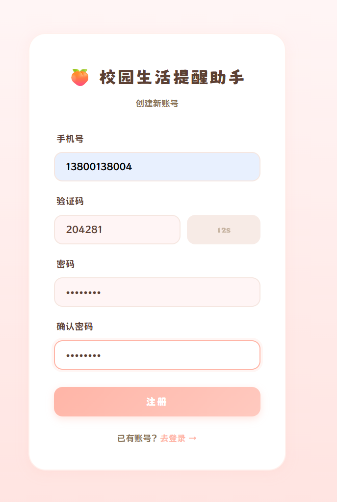
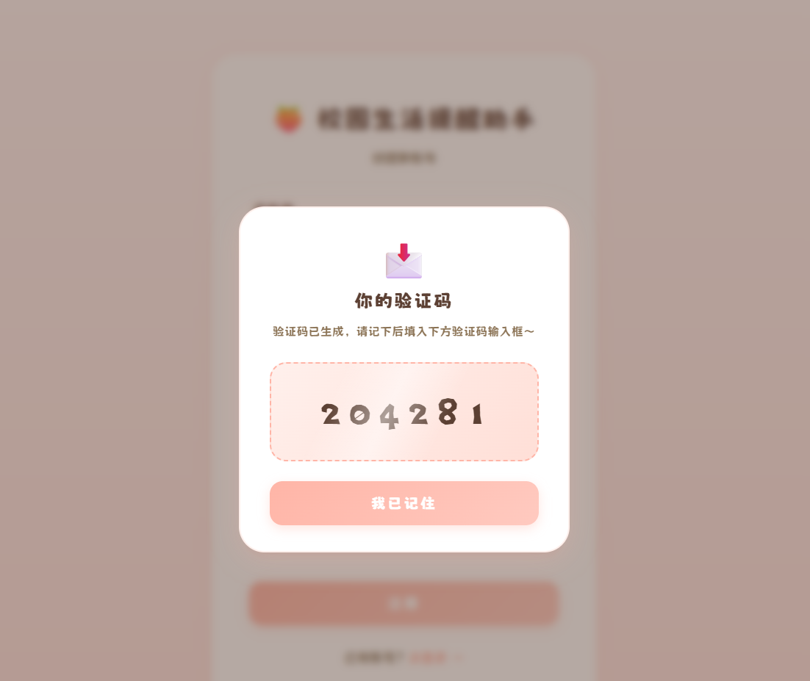

### 2.2 登录

1. 在登录页面（路径：`/login`）输入手机号与密码。
2. 点击 **登录**，登录成功后自动跳转到主页。
3. 登录信息会保存在本地，下次访问无需重复输入。

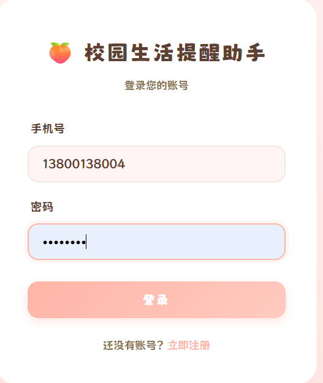
---

## 3. 对话页

主页默认展示对话页。你可以在底部输入框中直接用自然语言与 RemindMe 交流，例如：

- "明天下午 3 点开会"
- "等会提醒我喝水"
- "每周一早上 8 点去跑步"
- "明天天气怎么样？"

系统会根据你的输入自动判断意图，并触发相应的工具（创建提醒、查询、取消、天气查询等）。

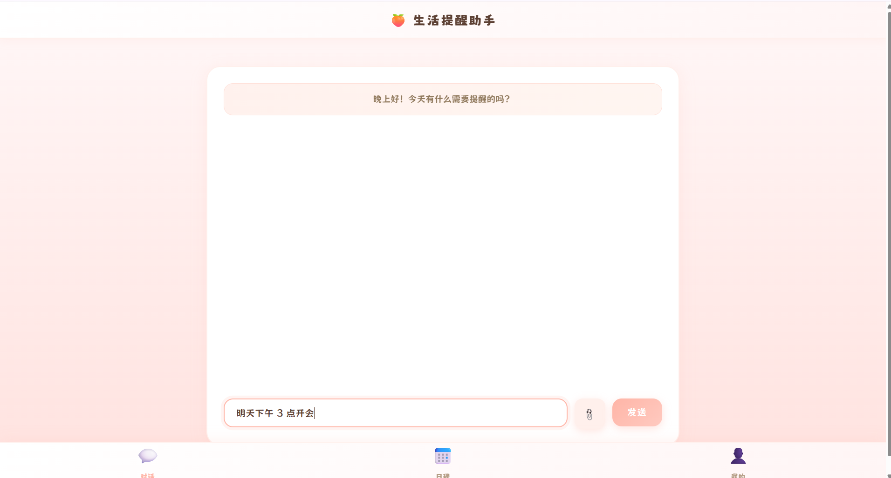

### 3.1 创建提醒

直接用一句话描述要提醒的事情，系统会自动识别时间与内容，并弹出确认卡片。根据你描述的时间方式不同，分为以下几种类型：

#### 3.1.1 定点提醒

明确指定某个时间点的提醒。例如：

> "明天下午 3 点开会"
> "周五上午 9 点交周报"
> "2026 年 8 月 10 日 14:00 去医院"

系统会解析出准确的提醒时间，并在卡片中显示。
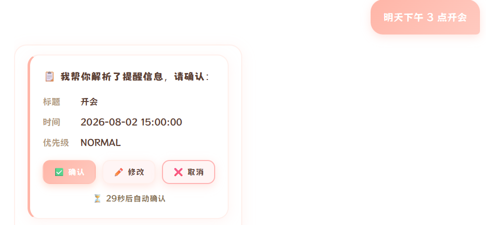

#### 3.1.2 模糊短时提醒

当你使用"等会"、"过一会"等模糊时间词时：

> "等会提醒我喝水"
> "过一会儿提醒我去拿快递"

系统会将提前分钟数（advanceMinutes）设为 0，并在卡片中显示为模糊短时提醒。你可以在确认卡片中通过"修改时间"按钮把它改为具体时间。
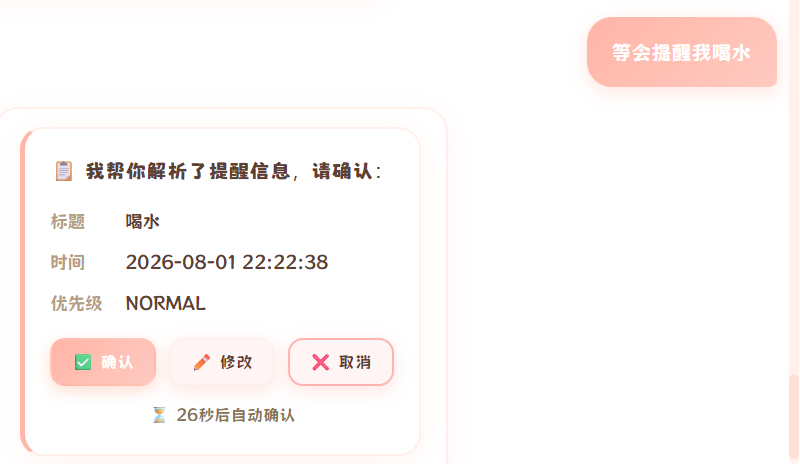
#### 3.1.3 周期提醒

需要按固定周期重复的提醒，例如：

> "每周一早上 8 点去跑步"
> "每天晚上 10 点睡觉"
> "每月 1 号交房租"

系统会创建周期提醒，并按设定的周期自动生成每次的提醒实例。

- 周期类型支持：每天、每周、每月
- 周期提醒的实例由系统每日凌晨 1 点自动生成当日及未来的实例

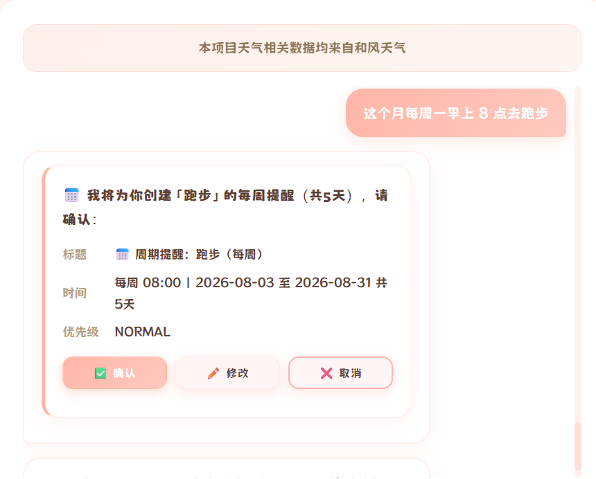
### 3.2 确认提醒（30 秒超时自动确认）

系统识别出你的提醒意图后，会弹出一张确认卡片，普通冲突卡片底部提供三个按钮，冲突卡片底部提供四个按钮：

| 按钮                | 作用 |
|-------------------| --- |
| ✅ **确认创建**        | 按卡片内容创建提醒 |
| 📝 **覆盖（冲突卡片独有）** | 用新内容覆盖原有提醒 |
| ✏️ **修改时间**       | 调整提醒的具体时间 |
| ❌ **取消**          | 取消本次创建 |

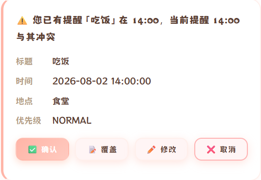
#### 30 秒自动确认机制

- 对于**单次提醒且无时间冲突**的情况，如果你在 30 秒内未进行任何操作，系统会**自动确认**并创建提醒，同时给你一条提示："超时未操作，已自动确认"。
- 对于**周期提醒**或**存在时间冲突**的会话，**没有自动确认机制**，必须由你手动点击按钮进行确认或取消。

> 提示：自动确认扫描每 15 秒执行一次，因此实际触发时间可能在 30 秒至 45 秒之间。

### 3.3 修改提醒

修改已有提醒有两种方式：

1. **对话方式**：直接告诉 RemindMe 你想修改什么，例如：
   > "把明天的开会提醒改成下午 4 点"

2. **确认卡片方式**：在创建过程中，点击卡片上的 ✏️ **修改时间** 按钮，可以直接调整时间。

修改完成后，系统会返回修改结果，并更新日历视图。

### 3.4 取消提醒（含模糊取消）

#### 精确取消

直接指定要取消的提醒，例如：

> "取消明天下午 3 点的开会提醒"

#### 模糊取消

通过关键词模糊匹配取消提醒，例如：

> "取消所有关于跑步的提醒"
> "把跟水有关的提醒都取消"

系统会根据关键词匹配相关提醒并进行取消操作。如果匹配到多条，会提示你确认。

> 注意：取消周期提醒时，可指定取消单次实例或整个周期。

### 3.5 查询提醒

直接用自然语言查询你的提醒列表，例如：

> "我明天有什么提醒？"
> "这周的提醒有哪些？"
> "下周三的安排"

系统会返回对应时间范围内的提醒列表，按时间顺序展示在对话中。

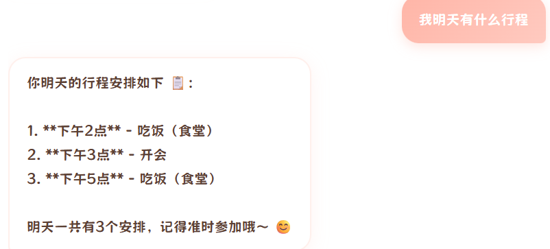

### 3.6 天气联动

RemindMe 集成了天气查询能力，支持以下查询：

| 查询类型 | 示例 |
| --- | --- |
| 实时天气 | "现在天气怎么样？" |
| 天气预报 | "明天会下雨吗？" |
| 空气质量 | "今天空气质量如何？" |
| 天气预警 | "有没有天气预警？" |

天气信息可与提醒结合使用，例如：

> "如果明天下雨，就提醒我带伞"

天气查询依赖你设置的城市，可在"我的页"中管理。

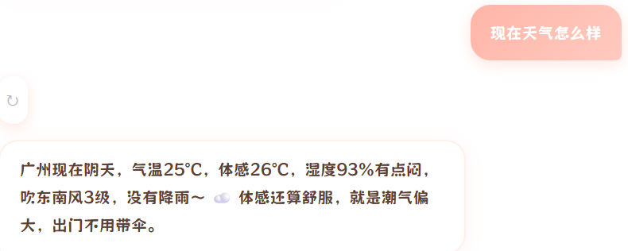
### 3.7 大通知解析

大通知解析面向**一整段大段通知文本**——如结构化的正式通知（会议/宣讲会通知，含"一、二、三"分点说明），可以直接把整段内容粘贴到对话中。RemindMe 会从大段文本中自动提取时间、地点、事项内容等关键信息，并创建一条提醒。

#### 适用场景

- **正式会议/活动通知**：如学院下发的宣讲会、座谈会通知，正文较长、分点说明时间地点与参会要求
- 其他含明确时间地点的长文本通知

#### 使用方法

直接把整段通知文本发给 RemindMe，例如一段正式通知：

> 关于召开数科院考研宣讲会的通知
> 各位同学：
> 为帮助同学们更好地了解考研形势……特邀经院院长来院开展硕士研究生招生专场宣讲会。现将有关事项通知如下：
> 一、宣讲会内容：1.单位介绍 2.专业介绍 3.发展与就业 4.招生专业目录 5.学费与联系方式
> 二、会议时间与地点
> 时间：2026 年 8 月 4 日（星期三）15:10
> 地点：教学楼 2 号楼504 教室
> 三、参会要求及加分说明：1.请参会同学提前 10 分钟到场签到……2.现场设有签退表，完成签退的同学将获得 1 分文体分。
> 四、特别提示：……请各年级同学相互转告，踊跃参加。
> 数科院 2026 年 7 月 3 日

系统会：

1. 从通知文本中自动提取时间、地点、事项内容、参会要求等关键信息；
2. 调用 `create_reminder` 工具创建一条提醒；
3. 创建成功后进入确认卡片流程，可在卡片上修改或取消。

#### 注意事项

- 通知需包含**明确的时间信息**，模糊时间（如"等会"）不会被识别为正式通知。
- 若与已有提醒存在时间冲突，会在确认卡片中提示。
- 创建成功的提醒仍会进入确认卡片流程，可在卡片上修改或取消。

#### 提前到场场景的特殊处理

很多大通知会包含"请提前 X 分钟到场签到/到达/入场"等要求。RemindMe 会自动识别这类要求，并按"双重提前"策略设置提醒：

| 项目 | 计算方式 |
| --- | --- |
| 应到场时间 | 通知原始时间 − 提前到场 X 分钟 |
| 卡片显示的提醒时间 | 应到场时间 − 10 分钟缓冲 |
| 实际推送时间 | 卡片显示时间 − 你的默认提前量（偏好设置） |
| 备注内容 | 原始会议时间、提前到场要求、地点、签退/加分等其他重要信息 |

**示例**：

> 通知原文："时间：2026 年 8 月 4 日 15:10；地点：教学楼 2 号楼 504 教室；请参会同学提前 10 分钟到场签到；完成签退获 1 分文体分"

系统会创建：

- 标题：考研宣讲会签到
- 提醒时间：2026-08-04 14:50（= 15:10 − 10 分钟到场 − 10 分钟缓冲）
- 地点：教学楼 2 号楼 504 教室
- 备注：宣讲会 15:10 开始；需提前 10 分钟到场签到（15:00 前到场）；完成签退可获 1 分文体分……

时间轴：

- 14:50 卡片显示时间（再往前由你的默认提前量再次提前触发推送）
- 15:00 前到场签到
- 15:10 宣讲会正式开始

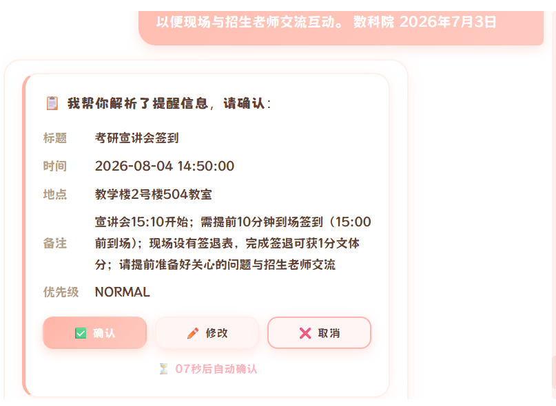

### 3.8 课表导入

如果你是学生用户，可以上传课表让 RemindMe 自动生成上课日程。

#### 支持的文件格式

- Excel（.xlsx）
- PDF

#### 操作步骤

1. 在对话中告诉 RemindMe："导入课表"，或点击对应入口。
2. 上传课表文件。
3. 系统识别后会弹出**课表时间配置卡片**，让你确认每节课的时间。
4. 卡片提供**联动模式**按钮，控制修改某节课时间时其他节如何联动：
   - **向下联动**（默认）：修改某节课时间，其后的所有课节时间顺延调整。
   - **向上联动**：修改某节课时间，其前的所有课节时间反向调整。
   - **双向联动**：前后课节均按相同间隔联动。
   - **互不影响**：仅修改当前课节，其他课节不变。
5. 确认时间配置后，点击 **生成日程**，系统将批量创建上课提醒。

> 默认时间表为 10 节课，识别失败时可在卡片中手动调整。

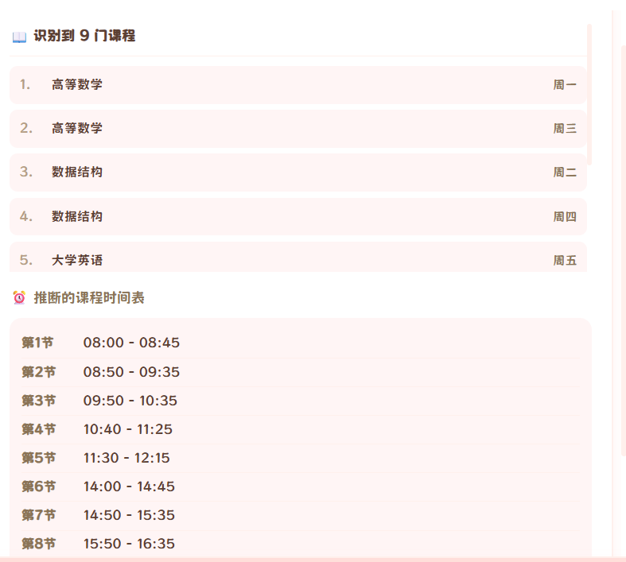
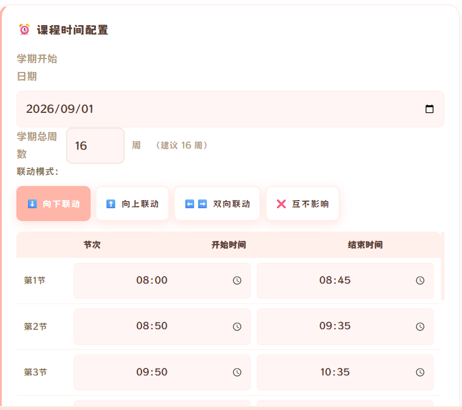
---

## 4. 日历页

点击底部导航的 **日历** 进入日历页，可按月或周查看提醒分布。

### 4.1 视图切换

- **月视图**：默认视图，展示整月提醒分布。
- **周视图**：展示一周内的提醒详情。

### 4.2 红点标识

日期下方出现**红点**，表示该日期有提醒。点击该日期可查看当日提醒列表。

### 4.3 颜色标识

日历与对话卡片中均使用颜色区分提醒类型与优先级：

| 颜色 | 含义 | 判定规则 |
| --- | --- | --- |
| 课程色 | 上课提醒 | 来源为 COURSE 或标题含"课" |
| 红色 | 紧急 | 优先级为 URGENT |
| 橙色 | 高优先级 | 优先级为 HIGH |
| 默认色 | 普通 | 优先级为 NORMAL |
| 灰色 | 低优先级 | 优先级为 LOW |
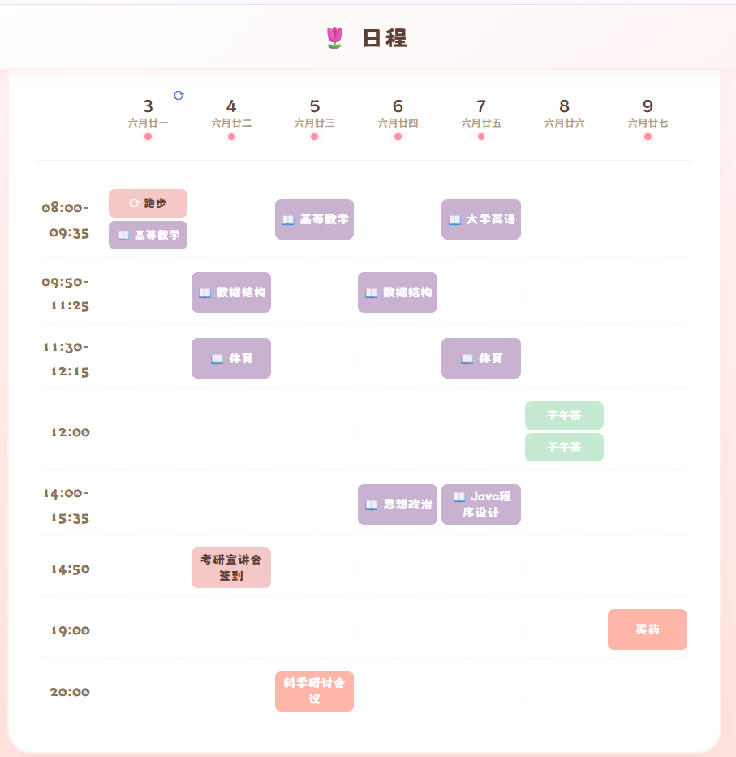
### 4.4 点击日期

点击任意日期，下方会展开该日期的提醒列表，按时间顺序排列。每条提醒显示标题、时间、优先级颜色条。

### 4.5 经期标记

如果你启用了经期管理，日历上会显示经期与排卵期的特殊标记：

- 🌙 经期标记
- 🌸 排卵期标记

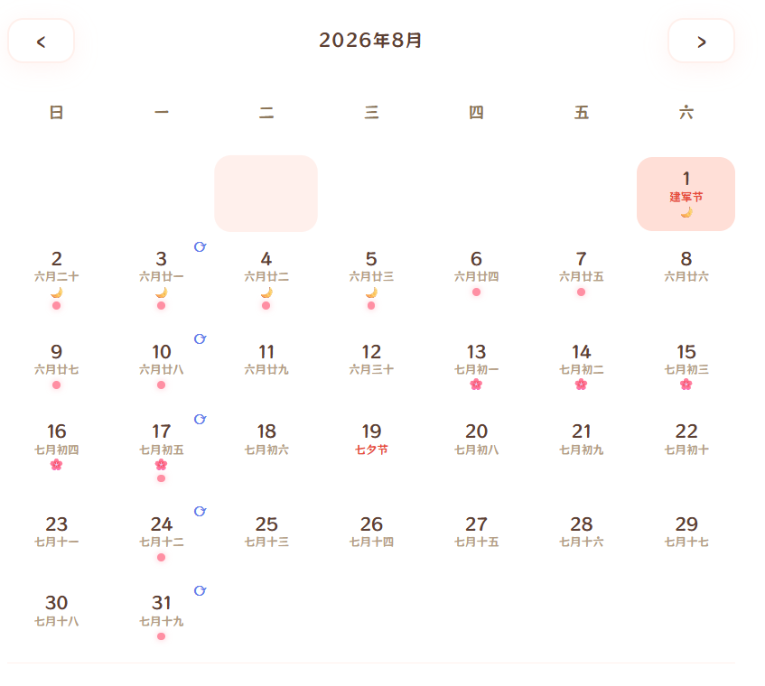
---

## 5. 我的页

点击底部导航的 **我的** 进入个人中心。

### 5.1 个人信息

展示你的基本资料，包括：

- 头像与用户名
- 手机号
- 性别
- 日程统计（提醒总数、已完成数、待执行数等）

可在此修改头像与基本资料。

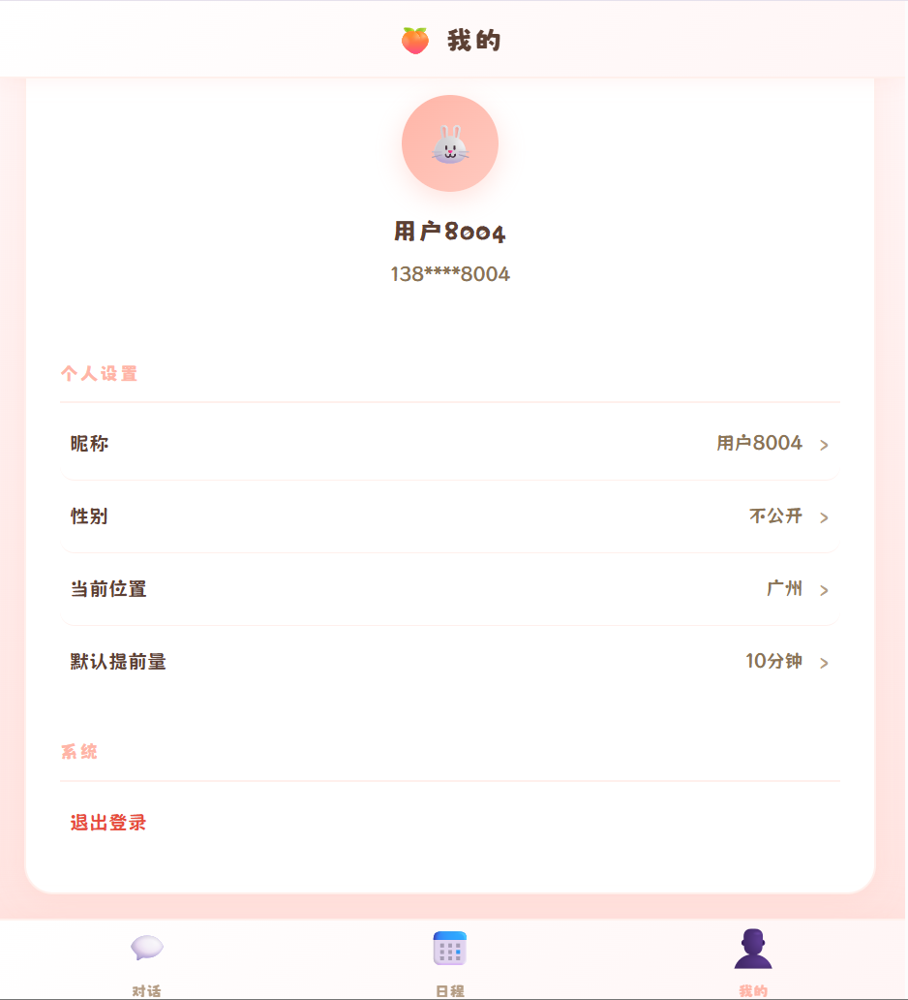
### 5.2 经期管理

经期管理界面提供以下设置项：

| 设置项 | 说明 |
| --- | --- |
| 周期天数 | 经期周期长度（默认 28 天） |
| 持续天数 | 经期持续天数（默认 5 天） |
| 上次经期开始日期 | 用于推算下次经期与排卵期 |
| 经期提醒开关 | 开启后，系统会在经前与经期开始时自动提醒 |

#### 经期相关提醒

- 系统每日 0:30 检查经期提醒，并在经前若干天提前通知。
- 经期开始后，日历会自动标记经期 🌙 与排卵期 🌸。
- 你也可以通过对话查询：

> "我的经期状态怎么样？"
> "下次经期是什么时候？"

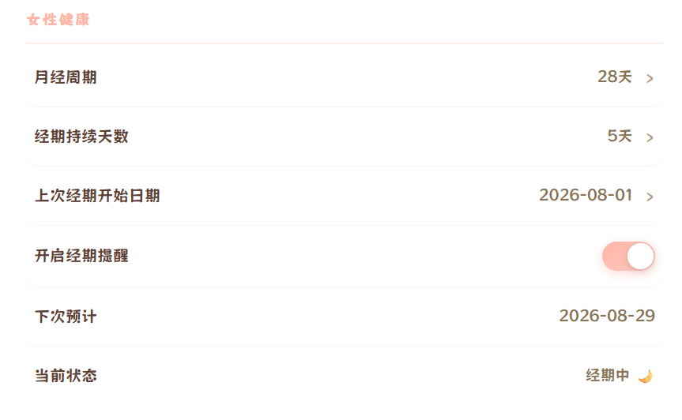
---

## 6. 常见问题（FAQ）

### Q1：我说话后没有弹出确认卡片怎么办？

A：请检查以下几点：
- 网络是否正常连接。
- 是否已登录账号。
- 输入内容是否包含明确的时间或意图。如果只是闲聊，系统不会生成提醒卡片。
- 如果使用的是模糊时间词（如"等会"），请稍等片刻，系统可能需要更多上下文来确认意图。

### Q2：自动确认是什么意思？会不会误创建提醒？

A：为了避免你忘记确认而错过提醒，对于**单次且无时间冲突**的提醒，系统在确认卡片弹出 30 秒后若你未操作，会自动确认创建。系统会下发一条提示消息告知已自动确认。如果你不希望创建，可以在收到提示后立即用"取消"指令撤销。

> 周期提醒和存在冲突的提醒**不会**自动确认，必须手动操作。

### Q3：周期提醒怎么删除整个周期？

A：直接告诉 RemindMe "取消 [周期提醒内容] 的所有提醒"即可。例如：

> "取消每周一跑步的所有提醒"

### Q4：课表识别错了怎么办？

A：在课表时间配置卡片中，你可以手动修改每节课的时间，也可以使用联动模式快速调整。如果识别结果偏差较大，建议使用 Excel 格式重新上传，识别准确率更高。

### Q5：天气查询的城市怎么设置？

A：在"我的页"中管理你的常驻城市。设置后，所有天气查询默认使用该城市，你也可以在对话中临时指定其他城市，例如"北京今天天气怎么样？"。

### Q6：经期提醒一直没收到，怎么排查？

A：请检查：
- 经期管理界面中的"经期提醒开关"是否已开启。
- "上次经期开始日期"是否填写正确。
- 周期天数与持续天数是否合理。
- 系统每日 0:30 才会扫描经期提醒，若刚设置完，需等到次日才会生成提醒。

### Q7：日历上的颜色分别代表什么？

A：详见 [4.3 颜色标识](#43-颜色标识)。简单记法：
- 红色 = 紧急
- 橙色 = 高优先级
- 灰色 = 低优先级
- 课程色 = 上课
- 默认色 = 普通提醒

### Q8：我能在手机上使用 RemindMe 吗？

A：RemindMe 为网页应用，可通过手机浏览器访问。建议使用主流浏览器（Chrome、Edge、Safari）以获得最佳体验。

---

> 如在使用过程中遇到本手册未涵盖的问题，请通过开发团队提供的反馈渠道进行反馈。
