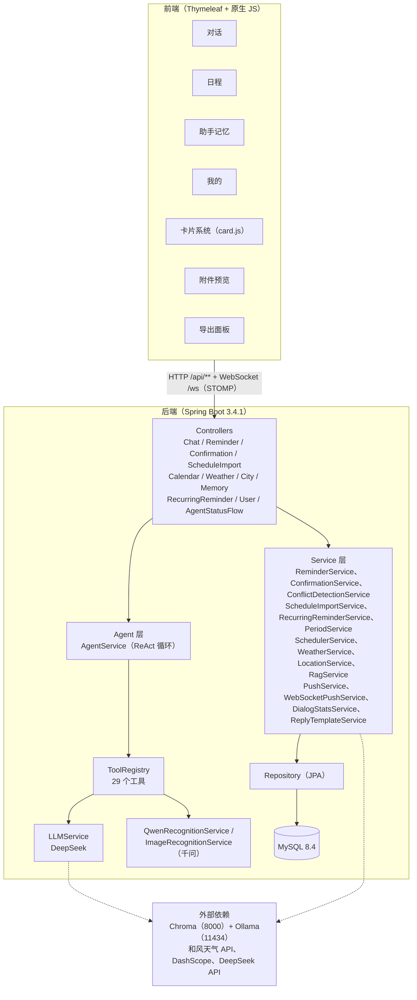
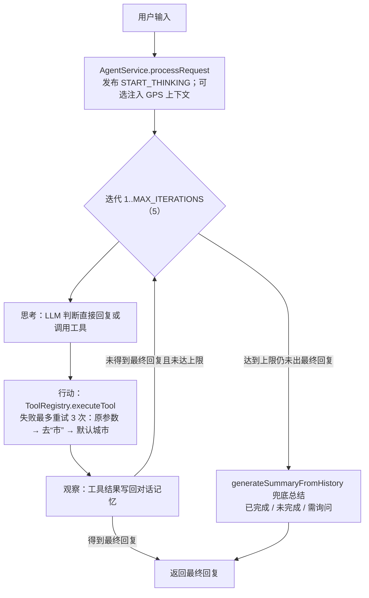
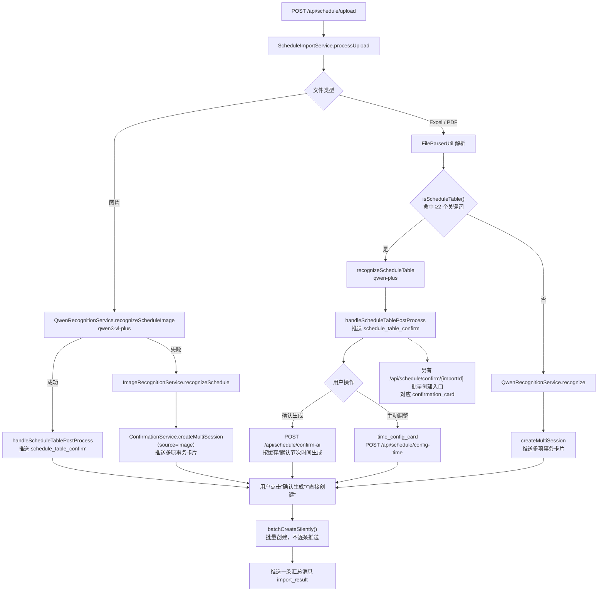
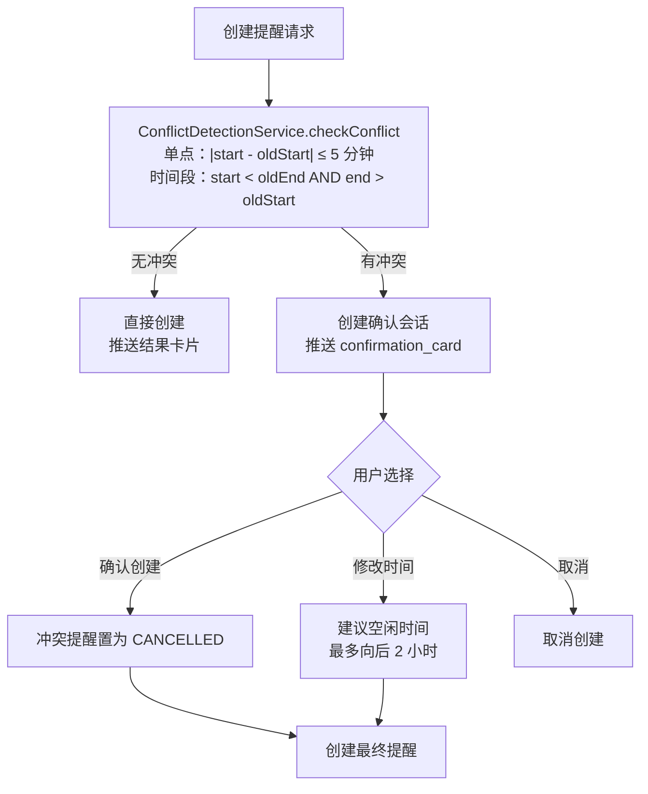
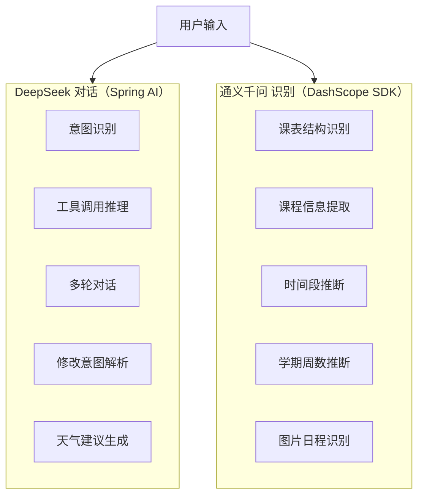
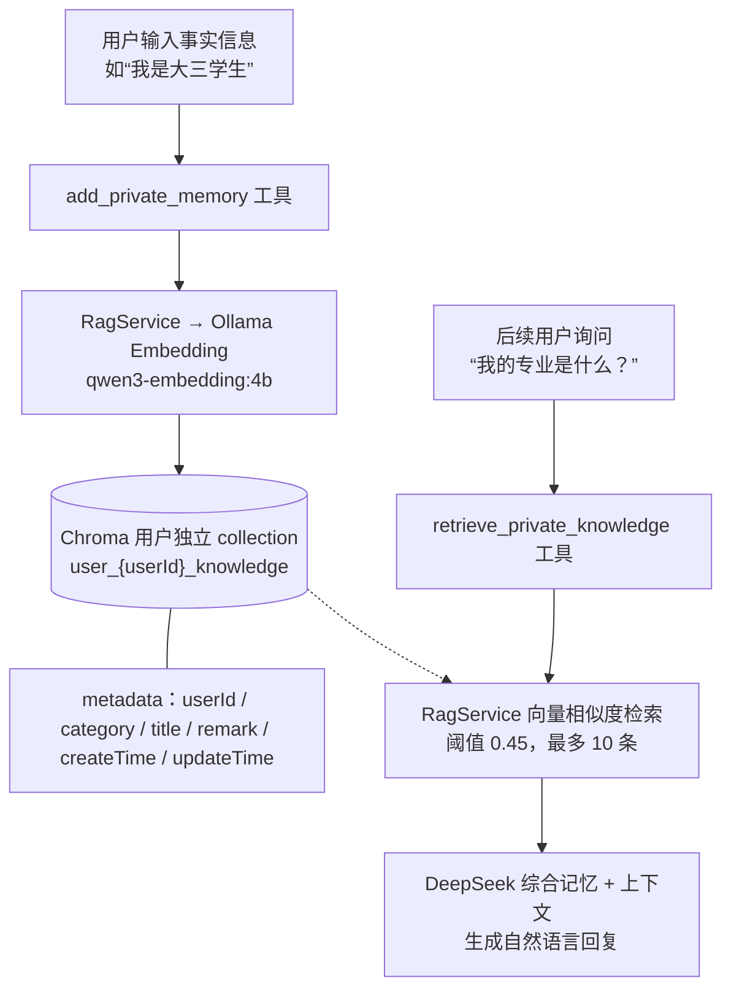

# RemindMe 智能提醒系统 - 项目报告

## 目录

1. [项目背景](#1-项目背景)
2. [需求分析](#2-需求分析)
3. [系统架构设计](#3-系统架构设计)
4. [核心技术实现细节](#4-核心技术实现细节)
5. [代码结构](#5-代码结构)
6. [优化方案](#6-优化方案)
7. [应用价值](#7-应用价值)
8. [测试结果](#8-测试结果)

---

## 1. 项目背景

### 1.1 项目概述

RemindMe（Life Reminder）是一个基于 AI 大模型的智能提醒管理系统，通过自然语言对话、课表/日程附件导入、周期提醒、助手记忆等方式帮助用户管理日常事项。系统基于 Spring Boot 3.4.1 + Spring AI 1.1.4 构建，由 DeepSeek 大模型驱动 ReAct（思考-行动-观察）智能体，通义千问（qwen-plus / qwen3-vl-plus）负责课表与图片识别，Chroma + Ollama 提供向量记忆能力。前端为 Thymeleaf 单页应用，包含「对话、日程、助手记忆、我的」四个页签（`templates/index.html`）。

### 1.2 开发背景

传统提醒应用存在以下痛点：
- **输入繁琐**：用户需要手动填写标题、时间、地点等字段，操作步骤多
- **课表管理低效**：学生用户每学期初需要手动录入大量课程提醒，重复劳动
- **冲突感知弱**：多个提醒时间重叠时缺乏智能检测和处理机制
- **交互单一**：仅支持表单输入，不支持自然语言对话

RemindMe 针对以上痛点，提供以下核心能力：
- **自然语言创建提醒**：用户说"明天下午3点提醒我开会"，`create_reminder` 工具自动解析并创建
- **一句话多项事项**：输入包含多个事项时由 `CreateMultiRemindersTool` 的 `create_multi_reminders` 统一处理，避免拆成多次调用
- **附件/课表导入**：支持 Excel、PDF、图片上传，`QwenRecognitionService` 识别课程或日程后批量生成提醒
- **智能冲突检测**：`ConflictDetectionService` 对单点提醒按 ±5 分钟窗口、时间段提醒按区间重叠检测，通过确认卡片让用户选择处理方式
- **实时 WebSocket 推送**：确认卡片、执行卡片、导入结果、Agent 状态流通过 STOMP 实时推送到前端
- **RAG 长期记忆**：基于 Chroma 向量库、按用户隔离 collection，支持"记住我的偏好"，并提供独立的助手记忆页面（筛选、备注、删除、导出）
- **多模型协同**：DeepSeek 负责对话推理与工具调用，通义千问负责文本/图片结构化识别
- **周期提醒与经期管理**：`RecurringReminderService` 支持每日/每周/每月模板及例外日期；`PeriodService` 提供经期状态、预测与设置
- **Agent 状态流**：每轮对话的每个步骤以 `AgentStatusEvent` 推送并落库 `agent_status_flows`，刷新后可回放

### 1.3 技术选型

| 类别 | 技术 | 版本 | 选型理由 |
|------|------|------|----------|
| 开发框架 | Spring Boot | 3.4.1 | 成熟的企业级框架，生态完善 |
| 编程语言 | Java | 21 | 虚拟线程、模式匹配等新特性提升开发效率 |
| AI 框架 | Spring AI | 1.1.4 | 原生集成大模型调用，支持 Tool Calling |
| 大语言模型（对话） | DeepSeek | deepseek-v4-flash | 通过 Spring AI OpenAI 兼容接口调用，支持 Function Calling |
| 大语言模型（识别） | 通义千问 (Qwen) | qwen-plus / qwen3-vl-plus | 通过 DashScope SDK 调用：文本用 qwen-plus，图片用 qwen3-vl-plus |
| 向量嵌入模型 | Ollama | qwen3-embedding:4b | 本地 Embedding 服务，用于 RAG 向量化 |
| 向量数据库 | Chroma | 本地部署 | RAG 知识库存储（公共手册 + 每用户私有记忆） |
| 数据库 | MySQL | 8.4 | 关系型数据存储，支持事务 |
| ORM 框架 | Spring Data JPA | - | 简化数据访问层开发 |
| 实时通信 | WebSocket (STOMP) | - | 全双工通信，支持用户级定向推送 |
| 模板引擎 | Thymeleaf | - | 服务端渲染前端页面 |
| 安全 | Spring Security + BCrypt | - | 密码散列存储 |
| 文档解析 | Apache POI / PDFBox | 5.3.0 / 3.0.3 | 解析 Excel 与 PDF 附件 |
| 其他 | Lunar / Lombok | 1.7.7 / 1.18.46 | 农历节日计算、消除样板代码 |

---

## 2. 需求分析

### 2.1 功能需求

#### 2.1.1 AI 智能对话

- 用户通过自然语言与系统对话（`ChatController` 的 `POST /api/chat/send`）
- Agent 模式由 `agent.enabled` 开关控制（`application.yml` 为 `true`，代码默认值 `false`）；仅当 Agent 分支抛出异常时才回退传统解析流程
- 支持多轮对话上下文记忆（`ConversationMemory`，保留 `agent.max-history: 10` 条，30 分钟未访问自动过期）
- 支持工具调用：`ToolRegistry` 启动时扫描 `@AgentTool`，当前共 29 个：提醒 8、记忆 6、天气 4、位置 2、经期 4、用户偏好 2、时间 2、多项创建 1
- 每轮对话以 `AgentStatus` 状态流展示"理解意图 → 调用工具 → 生成回复"过程（`AgentStatusEvent` 经 `/queue/messages` 推送，终态落库）
- 条件逻辑处理："如果明天下雨就提醒我带伞"（`query_weather_forecast` + `create_reminder`）

#### 2.1.2 提醒管理

- 创建提醒：`create_reminder`（自然语言）/ `ReminderController.createReminder`（表单）
- 时间段提醒：支持开始时间和结束时间（`endTime`）
- 周期提醒：`create_recurring_reminder` / `RecurringReminderController`，支持 DAILY / WEEKLY / MONTHLY，WEEKLY 可指定星期组合，支持例外日期
- 冲突检测：`ConflictDetectionService` 创建时检测，±5 分钟窗口 / 时间段重叠
- 确认会话：阶段一信息确认（普通单条 30 秒超时；含冲突或周期模板时 `expiresAt=null` 不超时）+ 阶段二执行确认（执行卡片，超时 = `intervalMinutes × 60` 秒）
- 优先级管理：LOW / NORMAL / HIGH
- 状态机：`ReminderStatus`（PENDING/REMINDED/SENT/COMPLETED/CANCELLED/EXPIRED）+ `ConfirmStatus`（PENDING/CONFIRMED/CANCELLED/DEFAULTED）+ `ExecutionStatus`（PENDING/CONFIRMED/CANCELLED/DEFAULTED）
- 导出：`export_reminders` 工具与 `ReminderController.exportReminders`，前端支持 Excel / PNG 两种格式

#### 2.1.3 课表与日程导入

- 文件上传与解析：Excel（POI）、PDF（PDFBox）、图片（Base64）
- AI 自动识别：`QwenRecognitionService.recognizeScheduleTable`（文本）/ `recognizeScheduleImage`（图片）
- 课表检测：`ScheduleImportService.isScheduleTable()` 命中 ≥2 个关键词即判定
- 时间配置：`CourseTimeConfigDTO` 配置每节课开始/结束时间
- 学期配置：设置学期开始日期和总周数
- 时间联动：前端 `propagateDownward` / `propagateUpward` 自动推算前后节次时间
- 批量创建：`batchCreateSilently` 静默创建，避免消息轰炸
- 手动创建：`manual_create_card` 手动输入课程
- 图片识别：优先 `QwenRecognitionService.recognizeScheduleImage`（qwen3-vl-plus）识别课表；失败时回退 `ImageRecognitionService.recognizeSchedule`，识别结果走多项事务确认卡片
- 大小限制：超过 10MB 仅记录 warn、不拒绝；支持 xlsx/xls/pdf/jpg/jpeg/png/gif/webp

#### 2.1.4 冲突处理

- 冲突检测算法：单点提醒（±5 分钟）和时间段提醒（区间重叠）
- 冲突卡片推送：通过 WebSocket 推送到 `/queue/confirmations`
- 用户操作选项：确认创建、覆盖（将被覆盖的冲突提醒置为 `CANCELLED`，不做物理删除）、修改时间、取消
- 批量覆盖：支持勾选多个冲突提醒进行批量覆盖
- 周期提醒冲突策略：SKIP（跳过冲突日）/ OVERWRITE（覆盖冲突）/ ALLOW_COEXIST（并存）
- 卡片状态恢复：取消修改时恢复原始卡片数据

#### 2.1.5 天气服务

- 实时天气查询：和风天气 `/v7/weather/now`
- 24 小时预报：`/v7/weather/24h`
- 多日预报：`/v7/weather/{3d|7d|10d|15d|30d}`
- 空气质量：`/airquality/v1/current/{lat}/{lon}`
- 天气预警：`/weatheralert/v1/current/{lat}/{lon}`
- 中文城市名转换：`LocationService.searchCities` 调用 `/geo/v2/city/lookup`，最多返回 5 个候选
- 天气提醒联动：SchedulerService 推送执行卡片时按城市分组查询天气并生成建议
- 已移除高德 API，位置查询统一走和风城市搜索

#### 2.1.6 RAG 知识库与长期记忆

- **私有记忆存储**：用户事实信息自动存入 Chroma 用户独立 collection（`user_{userId}_knowledge`）
- **语义检索**：`retrieve_private_knowledge` 按 `similarityThreshold=0.45` 过滤，最多返回 10 条
- **记忆管理**：`MemoryController` 提供列表、备注编辑、单条/批量删除、JSON/TXT 导出
- **AI 生成字段**：内容由 AI 写入，分类由 `classifyMemoryCategory` 生成、标题由 `generateMemoryTitle` 生成
- **备注**：备注是用户唯一可手动编辑的字段（`updateMemoryRemark`）
- **分类管理**：`MemoryCategory` 共 11 个分类
- **公共知识库**：`public_knowledge` collection，启动时从 `public_knowledge.json` 导入系统使用手册
- **Embedding 模型**：本地 Ollama 运行 `qwen3-embedding:4b`
- **变更通知**：记忆增删改发布 `PrivateMemoryChangedEvent`，前端收到 `PRIVATE_MEMORY_CHANGED` 后刷新

#### 2.1.7 多模型协同

- **DeepSeek（对话模型）**：负责 AI 对话、意图识别、工具调用推理、修改意图解析、天气建议、记忆分类与标题生成、提醒话术模板
- **通义千问（识别模型）**：`qwen-plus` 负责文本/表格识别，`qwen3-vl-plus` 负责图片识别
- **模型隔离**：DeepSeek 通过 Spring AI `ChatModel` 调用；千问通过 DashScope SDK 直接调用
- **API Key 管理**：均从 `application.yml` 读取，支持环境变量注入（`DEEPSEEK_API_KEY`、`DASHSCOPE_API_KEY`）

#### 2.1.8 日历视图

- 月历/日视图/周视图：`CalendarController` 的 `/month`、`/day`、`/week`
- 日期跳转器：前端 `jumpDateModal`
- 周期模板标记与经期状态：`/period-status`
- 按日期筛选提醒、可视化提醒密度

#### 2.1.9 周期提醒与经期管理

- 周期模板：`RecurringReminder`（标题、时间、重复类型、起止日期、`repeatDays`、`excludedDates`）
- 模板操作：暂停/恢复/取消/修改（`pauseRecurringReminder` / `resumeRecurringReminder` / `cancelRecurringReminder` / `updateRecurringReminder`）
- 经期管理：`PeriodService` 提供 `get_period_status`、`get_next_period`、`update_period_start`、`update_period_settings`
- 经期提醒：每日 0:30 扫描（`SchedulerService.checkPeriodReminders`）

### 2.2 非功能需求

| 需求 | 指标 |
|------|------|
| 响应时间 | DeepSeek 单次调用 read-timeout 30s；单轮最多 5 次迭代 / 5 次工具调用 |
| 并发能力 | 当前单实例部署，数据库连接池最大 10 |
| 可靠性 | 经期提醒等 `PushService` 推送写入 `PushLog`；Agent 状态流落库 `agent_status_flows` |
| 时区一致性 | 全系统 Asia/Shanghai（`RemindMeApplication` 启动时锁定 JVM 时区） |
| 安全性 | 密码 BCrypt 加密存储；`SecurityConfig` 放行全部请求，接口按 `userId` 隔离数据 |

---

## 3. 系统架构设计

### 3.1 整体架构



### 3.2 Agent 架构（ReAct 模式）

系统采用 ReAct（Reasoning + Acting）模式实现 AI 智能体调度（`agent/AgentService.java`）：



- 工具调用上限 `MAX_TOOL_CALLS=5`；LLM 返回空响应时用简化提示重试 1 次，仍为空则返回降级提示
- 状态流：每步发布 `AgentStatusEvent`（`THINKING`、`CALLING_*`、`GENERATING_REPLY`、`DONE`/`ERROR`），前端按 `flowId` 聚合为一个气泡
- 防死循环：相同工具+相同参数重复调用 2 次即强制兜底；"中文演戏格式"连续拦截超过 2 次不再提示
- 持久化：终态由 `AgentStatusFlowPersistListener` 写入 `agent_status_flows`，刷新后通过 `/api/agent/status-flows` 回放

### 3.3 课表/附件导入流程



### 3.4 冲突检测与处理流程



---

## 4. 核心技术实现细节

### 4.1 Agent 智能体调度（DeepSeek 驱动）

**文件**: `agent/AgentService.java` + `service/LLMService.java`

系统实现了基于 ReAct 模式的智能体调度器，由 DeepSeek 大模型驱动推理：

#### 双模型架构



- **DeepSeek 配置**：`spring.ai.openai.base-url: https://api.deepseek.com`，`model: deepseek-v4-flash`，`temperature: 0.3`，`max-tokens: 4096`，并关闭 V4 思考模式（`extra-body.thinking.type: disabled`）
- **通义千问配置**：`QwenConfig` 读取 `dashscope.api.key`（支持 `DASHSCOPE_API_KEY` 环境变量），`QwenRecognitionService` 使用 DashScope SDK 调用
- **LLMService** 注入 Spring AI `ChatModel`，提供 `parseReminder`、`chatWithTools`、`chatWithoutTools`、`parseToolCalls`、`parseEditIntent`、`generateWeatherSuggestion`、`classifyMemoryCategory`、`generateMemoryTitle`、`judgeLocationType`、`resolveReminderLocation`、`generateReminderTemplate`、`generateSummaryFromHistory` 等能力；`doChatWithRetry` 对 `RestClientException` 最多重试 3 次（100/200/400ms 退避），4xx 立即失败

#### ReAct 调度核心

- **迭代控制**：`MAX_ITERATIONS=5` 和 `MAX_TOOL_CALLS=5` 防止无限循环；LLM 空响应先简化重试 1 次
- **工具注册**：`ToolRegistry` 扫描容器中所有 `@AgentTool` 方法，共 29 个工具（提醒 8、记忆 6、天气 4、位置 2、经期 4、用户偏好 2、时间 2、多项创建 1）
- **工具执行容错**：`executeToolCall` 失败后最多重试 3 次（原参数 → 去掉地点末尾“市” → 用户默认城市），退避 100/200ms
- **对话记忆**：`ConversationMemory` 维护多轮对话上下文（`agent.max-history` 默认 10，超限保留末尾 N 条，30 分钟未访问过期）
- **事件驱动**：通过 `EventPublisher` 发布 `ReminderCreatedEvent`、`ReminderConfirmedEvent`、`ReminderCancelledEvent`、`AgentStatusEvent`
- **位置感知**：支持注入 GPS 坐标上下文，提示模型调用 `get_location`
- **状态流**：`AgentStatus` 枚举定义 27 个阶段，`DONE`、`TOOL_RESULT`、`ERROR` 为终态；前端按 `flowId` 聚合展示

#### System Prompt 工程

`LLMService.buildSystemPromptWithTools()` 按模块拼接 System Prompt：

- `buildCoreIdentity()`：核心身份定位
- `buildJudgmentCriteria()`：三个判断标准（是否值得记忆、关联哪些记忆、缺信息时问还是猜）
- `buildWorkflow()`：四步工作流程
- `buildRules()`：铁律（工具调用输出格式、先调用工具再回复、决策前检索、自动记忆、天气判断、复合任务、冲突策略、多事项识别等）
- `buildLocationExtractionRules()` / `buildNoteExtractionRules()` / `buildExportRules()`：位置、备注、导出专项规则
- 动态注入当前时间与全部工具定义

#### JSON 工具调用解析

`parseToolCalls` 支持三种格式：
- 标准格式 `{"tool_call": {"name": "...", "arguments": {...}}}`
- OpenAI 格式 `{"function_call": {"name": "...", "arguments": "..."}}`
- 简化格式 `{"tool": "...", "arguments": {...}}`

解析容错机制：
- `fixJson`：修复 Markdown 代码块标记、缺失闭合括号、尾随逗号、未转义引号
- `extractAllTopLevelJsonObjects`：平衡括号扫描提取多个 JSON 对象
- `extractJsonFragment`：从混合文本中提取 JSON 片段
- `guessToolNameFromArguments`：缺少 `name` 时按参数特征推断工具名

### 4.2 课表 AI 识别

**文件**: `service/QwenRecognitionService.java` + `service/ImageRecognitionService.java`

使用通义千问大模型识别课表与日程：

- **文本模型**：`qwen-plus`（`recognize` / `recognizeScheduleTable`）
- **图片模型**：`qwen3-vl-plus`（`recognizeImage` / `recognizeScheduleImage`）
- **Prompt 设计**：`RECOGNIZE_PROMPT`、`IMAGE_PROMPT`、`SCHEDULE_TABLE_PROMPT` 结构化指导识别
- **表格结构**：Excel 解析后用 `|` 分隔列，AI 明确识别表格边界
- **合并规则**：同一课程连续多节合并为一条（`sectionIndices`）
- **课表检测**：`isScheduleTable()` 维护 50 个关键词（星期、节次、周次、教室、时间等），命中 2 个即判定
- **解析容错**：AI 返回的 JSON 可能包含 markdown 包裹，自动清理
- **重试策略**：最多 3 次；429 按 2000/4000/8000ms 退避，其余网络异常按 100/200/400ms 退避；其他 4xx 不重试
- **置信度兜底**：课表总置信度 < 0.5 时强制 `success=false`，识别失败返回空 DTO

### 4.3 时间推断与联动

**文件**: `static/js/main.js`（前端） + `service/ScheduleImportService.java`（后端）

#### 前端时间联动

- **双向联动**：`propagateDownward`（影响后续节次）/ `propagateUpward`（影响前面节次），由 `currentLinkMode` 控制
- **模板循环**：以已填节次的时长与课间为模板循环推算
- **合法性校验**：`validateAllSlots` 修复负间隔
- **用户标记**：`_userFilled` 标记区分用户手填与系统推算

#### 后端时间生成

- **学期周数**：用户配置的 `totalWeeks` 覆盖课程自带的 weeks 列表
- **日期计算**：`semesterStart.plusWeeks(week - 1)` 计算每周日期
- **节次映射**：课程节次索引映射到时间段的开始/结束时间
- **单双周过滤**：支持 oddWeek（单周）/ evenWeek（双周）过滤
- **配置持久化**：`ScheduleImport` 保存 `totalWeeks`、`semesterStartDate`

### 4.4 冲突检测算法

**文件**: `service/ConflictDetectionService.java`

- **窗口常量**：`CONFLICT_WINDOW_MINUTES = 5`
- **单点提醒**：新提醒时间 ±5 分钟窗口内存在已有提醒即冲突
- **时间段提醒**：`newStart.isBefore(oldEnd) && newEnd.isAfter(oldStart)` 判定区间重叠
- **检测范围**：仅统计有效提醒，修改提醒时排除自身 ID
- **建议时间**：以 `max(提醒时长, 5 分钟)` 为步长向后寻找空闲时段，最多只搜索 2 小时，找不到则返回 `from + 2h`
- **候选过滤**：建议时间检测只统计 `status != CANCELLED` 且 `confirmStatus = CONFIRMED` 的提醒
- **检测时机**：创建确认会话时检测，而非最终创建时

### 4.5 WebSocket 实时推送

**文件**: `config/WebSocketConfig.java` + `service/WebSocketPushService.java`

- **端点**：`/ws`，启用 `/topic` 与 `/queue` 代理，`setAllowedOriginPatterns("*")`
- **用户级定向推送**：`convertAndSendToUser` 推送到 `/user/queue/*`
- **握手认证**：`DefaultHandshakeHandler` 优先读取请求头 `user-id`，其次读取查询参数 `user-id`，缺失时回退为 `1`
- **推送目标**：
  - `/queue/confirmations` - 确认卡片（`confirmation_card`、`multi_confirmation_card`、`schedule_table_confirm`）
  - `/queue/messages` - 执行卡片（`execute_card`）、Agent 状态流、待确认提示、执行结果、导入结果、记忆变更通知
  - `/queue/reminders` - `PushService.pushReminder` 的通用提醒通道（`type=REMINDER`，经期提醒使用）
- **消息类型**：`AGENT_STATUS`、`PRIVATE_MEMORY_CHANGED`、`single_confirm_card`、`multi_confirm_card`、`pending_summary`、`card_confirmed`、`card_cancelled`、`execution_result`、`batch_confirm_result`、`batch_cancel_result`、`import_result`、`timeout`、`timeout_auto_create` 等
- **前端订阅**：`/user/queue/confirmations` 与 `/user/queue/messages`，连接地址为 `/ws?user-id={userId}`；断线 5 秒重连
- **批量导入优化**：`batchCreateSilently` 只推送一条汇总消息（`import_result`）

### 4.6 确认卡片系统

**文件**: `dto/response/ConfirmationCardResponse.java` + `service/ConfirmationService.java`

确认卡片通过 `type` 字段区分：

| 卡片/消息类型 | 说明 | 触发场景 |
|----------|------|----------|
| `confirmation_card` | 单条提醒/冲突确认卡 | 创建提醒检测到冲突或需信息确认 |
| `confirmation_card`（批量） | 批量导入确认卡（timeout=300） | 课表批量创建前 |
| `single_confirm_card` | 单条待确认提示 | 用户说"确认"且仅一个待确认项 |
| `multi_confirm_card` | 多条待确认汇总提示 | 用户说"确认"且有多个待确认项 |
| `pending_summary` | 待确认汇总 | 创建会话后提示"还有 N 项待确认" |
| `multi_confirmation_card` | 多项事务卡 | 一句话多项创建/附件识别 |
| `execute_card` | 阶段二执行卡片 | 提醒到期，等待"已执行/稍后/取消" |
| `schedule_table_confirm` | 课表确认卡（timeout=600） | AI 识别课表后 |
| `time_config_card` | 时间配置卡（前端构造） | 用户点击"手动调整" |
| `manual_create_card` | 手动创建卡（前端构造） | 前端手动输入课程 |
| `card_confirmed` / `card_cancelled` | 卡片处理结果消息 | 确认/取消后回执 |
| `timeout` / `timeout_auto_create` | 超时消息 | 会话超时或超时自动创建 |
| `import_result` | 导入结果汇总 | 批量静默创建完成 |

超时规则：普通单条信息确认 `TIMEOUT_SECONDS = 30`；`isRecurring=true` 或 `hasConflict=true` 时 `expiresAt=null`；多项事务卡 `timeout=null`、`expiresAt=null`；执行卡 `timeout = intervalMinutes × 60`（默认 600 秒）；课表确认卡 `timeout=600`。前端 `card.js` 在 `expiresAt` 倒计时归零时会自动调用确认接口。

### 4.7 批量静默创建

**文件**: `service/ScheduleImportService.java`

- **问题**：逐条创建提醒会触发 N 次确认会话和 N 次 WebSocket 推送
- **方案**：`batchCreateSilently` 直接 `reminderRepository.save()`，跳过确认流程
- **结果**：N 条日程 → 1 条汇总消息
- **配置持久化**：`totalWeeks`、`semesterStartDate` 保存到 `ScheduleImport` 实体；`timeSections` 与完整课程数据缓存在 `ScheduleImportService.scheduleTableCache`，后续"直接创建"时优先读取用户配置而非默认值

### 4.8 天气服务集成

**文件**: `service/WeatherService.java` + `service/LocationService.java`

- **和风天气 API**：实时天气 `/v7/weather/now`、24 小时 `/v7/weather/24h`、多日预报 `/v7/weather/{days}d`、空气质量 `/airquality/v1/current/{lat}/{lon}`、预警 `/weatheralert/v1/current/{lat}/{lon}`
- **中文输出**：所有请求追加 `lang=zh-hans`
- **认证与超时**：API Key 通过请求头 `X-QW-Api-Key` 传递；连接/读取超时各 10000ms，仅 `SocketTimeout` 重试 3 次（100/200/400ms）
- **城市搜索**：`LocationService.searchCities` 调用 `/geo/v2/city/lookup?range=cn&number=5&lang=zh-hans`，最多返回 5 个候选；多候选交由 AI 选择，单候选直接返回标准名+坐标
- **位置判定**：`SchedulerService.judgeLocationType` 将地点分为 CITY/POI/PROVINCE/GARBAGE；PROVINCE、GARBAGE 不查天气，POI 降级到用户默认城市
- **推送建议**：SchedulerService 推送执行卡片时按城市分组查询天气，优先使用提醒话术模板（`noteTemplate` 的 `{weather}/{title}/{memory}` 占位符），无模板时调用 `generateWeatherSuggestion`
- **异常兜底**：省级行政区、乱码等无法解析为城市的地点不查询天气，直接推送执行卡片

### 4.9 时区与时间处理

- **全局时区**：`RemindMeApplication` 中 `@PostConstruct` 设置 JVM 默认时区为 `Asia/Shanghai`
- **DTO 序列化**：`LocalDateTime` 使用 `@JsonFormat(pattern = "yyyy-MM-dd HH:mm:ss", timezone = "Asia/Shanghai")`
- **时间工具类**：`TimeUtils` 统一提供 `now()`、`getCurrentBeijingTime()`、格式化器，时区常量 `TIMEZONE = "Asia/Shanghai"`

### 4.10 RAG 知识库与长期记忆

**文件**: `service/RagService.java` + `config/ChromaConfig.java`

系统基于 Chroma 向量数据库实现 RAG（检索增强生成）长期记忆：

#### 架构设计



#### 双重知识库

| 知识库 | 用途 | 工具 |
|--------|------|------|
| 私有记忆 | 用户个人事实信息（专业、习惯、偏好等），collection 按用户隔离 | `retrieve_private_knowledge` / `add_private_memory` / `update_private_memory` / `delete_private_memory` / `get_all_private_memories` |
| 公共知识 | 系统使用手册（`public_knowledge.json`） | `retrieve_public_knowledge` |

#### 记忆分类体系

`MemoryCategory` 共 11 个分类：PERSONAL_INFO（个人信息）、ACTIVITY（活动事务）、EVENT（重要日期）、PLAN（长期目标）、EXAM_SCHEDULE（考试安排）、HEALTH_CONDITION（健康状况）、DIET_PREFERENCE（饮食偏好）、HABIT（个人习惯）、INTEREST（兴趣爱好）、LANGUAGE_STYLE（语言风格）、OTHER（其他）

#### 关键实现

- **分类与标题**：写入时 `classifyMemoryCategory` 自动分类、`generateMemoryTitle` 自动生成标题；标题生成失败时截取正文前 20 字兜底
- **备注**：`updateMemoryRemark` 仅替换备注、保留分类/标题/创建时间
- **检索阈值**：`RETRIEVE_SIMILARITY_THRESHOLD = 0.45`，私有检索 `topK` 默认 50 但结果最多返回 10 条；公共知识库 `topK` 默认 5
- **全量拉取**：`getAllPrivateMemories` 使用近似查询 `"的"`、`topK=1000` 后按创建时间倒序
- **公共库导入**：`@PostConstruct initPublicKnowledge` 先以 `"的"`、`topK=1` 判空，再从 classpath `public_knowledge.json` 导入（6 条，`source=public`）
- **Chroma 重试**：`callWithRetry` 对 `RestClientException` 最多重试 3 次（100/200/400ms 退避），4xx 不重试
- **变更事件**：新增/更新/删除分别发布 `ADD/DELETE/UPDATE`；更新备注走删除重建路径，发布 `DELETE`
- **记忆页面**：`/api/memory/list`、`update-remark`、`delete`、`batch-delete`、`export?format=json|txt`

#### Embedding 方案

- **本地部署**：Ollama 运行 `qwen3-embedding:4b`，无需外部 API
- **配置**：`spring.ai.ollama.base-url: http://localhost:11434`
- **向量存储**：Chroma `http://localhost:8000`，公共 collection `public_knowledge`

### 4.11 定时任务与推送系统

**文件**: `service/SchedulerService.java` + `service/PushService.java` + `service/RecurringReminderService.java` + `service/ConfirmationService.java`

| 定时任务 | Cron | 作用 |
|----------|------|------|
| `scanPendingReminders` | `0 * * * * ?` | 每分钟扫描 `PENDING + CONFIRMED + ExecutionStatus.PENDING`、`remindTime < now+1天` 且 `remindTime - advanceMinutes(默认10) <= now` 的提醒；同一提醒距上次推送需 ≥ advanceMinutes 以避免重复；按城市分组查天气后推送执行卡片，状态置为 `REMINDED` 并更新 `lastConfirmRemindAt` |
| `checkConfirmTimeout` | `0 0 * * * ?` | 每小时检查 `confirmAttempts >= 3` 的提醒，仅记录日志，不自动确认 |
| `generateDailyRecurringInstances` | `0 0 1 * * ?` | 每日 1 点遍历 ACTIVE 周期模板，为当天生成实例，更新 `lastGeneratedDate` |
| `checkPeriodReminders` | `0 30 0 * * ?` | 每日 0:30 检查经期提醒 |
| `cleanupExpiredSessions` | `fixedRate = 15000` | 每 15 秒清理 `PENDING` 且 `expiresAt < now` 的会话：`INFO_CONFIRM` 超时自动创建并推送 `timeout_auto_create`；`REMINDER_EXECUTE` 跳过；其他置 `EXPIRED` 并推送 `timeout` |

#### 循环提醒

`RecurringReminderService.shouldGenerateForDate` 判断某日是否生成：

| 类型 | 说明 | 实例生成规则 |
|------|------|--------------|
| DAILY | 每日重复 | 周期范围内每天生成 |
| WEEKLY | 每周重复 | 按 `repeatDays`（1=周一…7=周日，逗号分隔）生成；为空时兼容旧数据退化为每天 |
| MONTHLY | 每月重复 | 每月与起始日同一天生成 |

- **例外日期**：`excludedDates` 为 JSON 数组，命中则不生成
- **实例表**：`RecurringInstance` 通过 `(recurringId, remindDate)` 唯一索引防重复
- **冲突处理**：生成实例时若冲突，不落实例，转交确认卡片流程

#### 推送渠道

`PushChannel` 枚举定义 `WEBSOCKET` / `EMAIL` / `SMS`，当前实际使用 WebSocket；`PushService.pushReminder` 每次推送会写入一条 `PushLog`（默认未读，`pushChannel=WEBSOCKET`），确认卡片与 Agent 状态流不经过 `PushLog`。

### 4.12 经期管理

**文件**: `service/PeriodService.java` + `entity/User.java`

- 关键常量：`DEFAULT_CYCLE_LENGTH=28`、`OVULATION_OFFSET=14`、`PREMENSTRUAL_DAYS=3`
- 用户字段：`cycleDays`（21-35）、`lastPeriodStart`、`periodDuration`（3-7）、`enablePeriodReminder`、`periodConfirmStatus`、`periodPostponedUntil`、`periodPostponeCount` 等
- 提醒条件：开启提醒、未推迟且距下次经期 ≤3 天；提醒时间 = 下次经期前一天 + `periodRemindTime`（默认 20:30）；已有 PENDING 经期提醒则跳过；推迟最多 3 次
- Agent 工具：`get_period_status`、`get_next_period`、`update_period_start`、`update_period_settings`
- 日历联动：`CalendarController` 的 `/period-status`

### 4.13 Agent 状态流持久化

**文件**: `agent/event/AgentStatusEvent*`、`entity/AgentStatusFlow.java`、`controller/AgentStatusFlowController.java`

- **写入**：`AgentStatusFlowPersistListener` 仅在终态 `DONE`/`ERROR` 落库；`DONE` 且总耗时 <300ms 直接跳过；内存缓冲 TTL 10 分钟、最多 200 个 flow
- **表结构**：`agent_status_flows`（`flow_id` 唯一、`user_id`、`final_status`、`total_steps`、`duration_ms`、`steps_json`、`created_at`）
- **查询**：`GET /api/agent/status-flows?userId=&limit=`，默认 50、最大 100，按创建时间倒序
- **前端**：`main.js` 收到 `AGENT_STATUS` 后按 `flowId` 更新状态气泡；刷新后与聊天历史按时间合并回放

### 4.14 提醒导出

**文件**: `controller/ReminderController.java` + `service/ReminderService.java` + `static/js/main.js`

- **接口**：`GET /api/reminders/export?userId=&startDate=&endDate=&statuses=`（按提醒 `createdAt` 左闭右开区间筛选；`statuses` 为逗号分隔多状态，不传默认 PENDING/COMPLETED/CANCELLED/EXPIRED）
- **Agent 工具**：`export_reminders`，返回 `action=export_reminders`、`downloadHint=excel` 供前端二次取数
- **前端导出面板**：日期范围（最近 7 天/30 天/全部/自定义）+ 状态多选 + Excel(.xlsx) / PNG
- **Excel 导出**：SheetJS 生成 9 列（序号/标题/提醒时间/结束时间/地点/备注/优先级/状态/创建时间）
- **PNG 导出**：`html2canvas`（scale=2、白底）渲染隐藏的 `#exportListView`

---

## 5. 代码结构

### 5.1 包结构总览

```
com.dormrepair.remindme
├── RemindMeApplication.java          # 启动类（锁定 JVM 时区）
│
├── agent/                             # AI 智能体
│   ├── AgentService.java              # ReAct 调度器
│   ├── AgentResponse.java             # 响应封装
│   ├── AgentTool.java                 # 工具注解
│   ├── ToolRegistry.java              # 工具注册中心（29 个工具）
│   ├── ToolCall.java                  # 工具调用封装
│   ├── ToolDefinition.java            # 工具定义
│   ├── ConversationMemory.java        # 对话记忆管理
│   ├── tool/
│   │   └── CreateMultiRemindersTool.java  # 多项事项批量创建
│   └── event/                         # 事件与状态流
│       ├── AgentEvent.java
│       ├── AgentStatus.java
│       ├── AgentStatusEvent.java
│       ├── AgentStatusEventListener.java
│       ├── AgentStatusFlowPersistListener.java
│       ├── AgentStatusMapper.java
│       ├── EventPublisher.java
│       ├── PrivateMemoryChangedEvent.java
│       ├── PrivateMemoryChangedEventListener.java
│       ├── ReminderCreatedEvent.java
│       ├── ReminderConfirmedEvent.java
│       └── ReminderCancelledEvent.java
│
├── config/                            # 配置类
│   ├── AppConfig.java
│   ├── LLMConfig.java                 # RestClient 超时配置（DeepSeek 模型在 application.yml）
│   ├── QwenConfig.java                # 通义千问配置（DashScope API Key）
│   ├── WebSocketConfig.java           # WebSocket 配置
│   ├── SecurityConfig.java            # 安全配置（BCrypt、放行请求）
│   ├── WeatherConfig.java             # 和风天气 API 配置
│   ├── ChromaConfig.java              # Chroma 向量数据库配置
│   └── WebConfig.java                 # Web MVC 配置
│
├── controller/                        # 控制器层
│   ├── ChatController.java            # AI 对话
│   ├── ReminderController.java        # 提醒管理/导出
│   ├── ConfirmationController.java    # 确认会话
│   ├── ScheduleImportController.java  # 课表/附件导入
│   ├── CalendarController.java        # 日历月/日/周视图
│   ├── WeatherController.java         # 天气查询
│   ├── RecurringReminderController.java # 周期提醒
│   ├── AgentStatusFlowController.java # Agent 状态流查询
│   ├── AuthApiController.java         # 认证 API
│   ├── AuthPageController.java        # 认证页面
│   ├── CityController.java            # 城市搜索
│   ├── IndexController.java           # 首页
│   ├── MemoryController.java          # 助手记忆页面接口
│   └── UserController.java            # 用户管理
│
├── dto/                               # 数据传输对象
│   ├── request/                       # 请求 DTO
│   │   ├── LoginRequest.java
│   │   ├── RegisterRequest.java
│   │   ├── SendCodeRequest.java
│   │   ├── ReminderCreateRequest.java
│   │   ├── ReminderUpdateRequest.java
│   │   ├── MemoryRequest.java
│   │   ├── MultiBatchRequest.java
│   │   ├── MultiItemModifyRequest.java
│   │   └── PeriodConfirmRequest.java
│   ├── response/                      # 响应 DTO
│   │   ├── AirQualityResponse.java
│   │   ├── CalendarResponse.java
│   │   ├── CitySearchResult.java
│   │   ├── ConfirmationCardResponse.java
│   │   ├── ConflictDetailResponse.java
│   │   ├── ConflictResponse.java
│   │   ├── KnowledgeResult.java
│   │   ├── LoginResponse.java
│   │   ├── PeriodStatusResponse.java
│   │   ├── ReminderExportDTO.java      # 提醒导出（9 个字段）
│   │   ├── ReminderResponse.java
│   │   ├── Result.java
│   │   ├── WeatherAlertResponse.java
│   │   ├── WeatherForecastResponse.java
│   │   ├── WeatherHourlyResponse.java
│   │   └── WeatherNowResponse.java
│   ├── BaseReminderFields.java
│   ├── ScheduleTableDTO.java
│   ├── ScheduleItemDTO.java
│   ├── CourseTimeConfigDTO.java
│   ├── ManualCourseDTO.java
│   ├── TimeSlotDTO.java
│   └── TaskDetail.java
│
├── entity/                            # JPA 实体
│   ├── Reminder.java                  # 提醒
│   ├── User.java                      # 用户
│   ├── ConfirmationSession.java       # 确认会话
│   ├── ScheduleImport.java            # 导入记录
│   ├── ScheduleImportItem.java        # 导入明细
│   ├── RecurringReminder.java         # 周期提醒模板
│   ├── RecurringInstance.java         # 周期实例
│   ├── PushLog.java                   # 推送日志
│   ├── UserDialogStats.java           # 对话统计
│   ├── AgentStatusFlow.java           # Agent 状态流
│   └── VerificationCode.java          # 验证码
│
├── enums/                             # 枚举
│   ├── ReminderStatus.java            # PENDING/REMINDED/SENT/COMPLETED/CANCELLED/EXPIRED
│   ├── ConfirmStatus.java / ExecutionStatus.java / FinalStatus.java
│   ├── StatusPendingSemantics.java / TaskStatus.java
│   ├── Priority.java                  # LOW/NORMAL/HIGH
│   ├── ReminderSource.java            # USER_INPUT/WEATHER_LINK/EXCEL_IMPORT/COURSE/PERIOD_REMINDER
│   ├── RepeatType.java                # DAILY/WEEKLY/MONTHLY
│   ├── MemoryCategory.java            # 11 个记忆分类
│   ├── PeriodStatus.java / Gender.java
│   ├── IntentType.java
│   ├── PushChannel.java               # WEBSOCKET/EMAIL/SMS
│   └── ...
│
├── service/                           # 业务服务层
│   ├── ReminderService.java           # 提醒管理 + Agent 工具
│   ├── ConfirmationService.java       # 确认会话/卡片推送
│   ├── ConflictDetectionService.java  # 冲突检测
│   ├── ScheduleImportService.java     # 课表/日程导入
│   ├── QwenRecognitionService.java    # 通义千问文本/图片识别
│   ├── ImageRecognitionService.java   # 图片日程识别
│   ├── LLMService.java                # DeepSeek 调用（对话/工具/意图/记忆）
│   ├── WeatherService.java            # 和风天气服务
│   ├── LocationService.java           # 和风城市搜索/定位
│   ├── WebSocketPushService.java      # WebSocket 推送
│   ├── PushService.java               # 推送服务（多渠道）
│   ├── SchedulerService.java          # 定时任务
│   ├── RecurringReminderService.java  # 周期提醒
│   ├── PeriodService.java             # 经期管理
│   ├── RagService.java                # RAG 记忆（Chroma + Ollama）
│   ├── UserService.java               # 用户服务
│   ├── TimeInferenceService.java      # 时间推断
│   ├── DialogStatsService.java        # 对话统计
│   ├── ReplyTemplateService.java      # 提醒回复/话术模板
│   └── VerificationCodeService.java   # 验证码
│
├── repository/                        # 数据访问层
│   ├── ReminderRepository.java
│   ├── UserRepository.java
│   ├── ConfirmationRepository.java
│   ├── ScheduleImportRepository.java
│   ├── ScheduleImportItemRepository.java
│   ├── RecurringReminderRepository.java
│   ├── RecurringInstanceRepository.java
│   ├── PushLogRepository.java
│   ├── UserDialogStatsRepository.java
│   ├── AgentStatusFlowRepository.java
│   ├── VerificationCodeRepository.java
│   └── ...
│
├── utils/                             # 工具类
│   ├── TimeUtils.java                 # 时间工具
│   ├── AgentDateService.java          # 日期工具（get_current_time / calculate_date）
│   ├── FileParserUtil.java            # Excel/PDF/图片解析
│   └── TaskSummaryUtils.java          # 任务摘要
│
├── exception/                         # 业务异常
└── handler/
    └── GlobalExceptionHandler.java    # 全局异常处理
```

### 5.2 前端结构

前端采用 Thymeleaf 单页应用模式，核心文件为 `templates/index.html`，脚本按职责拆分：

| 模块 | 文件 | 功能 |
|------|------|------|
| 聊天界面 | `index.html` + `main.js` | 消息展示、输入框（Enter 发送/Shift+Enter 换行）、附件上传、Agent 状态流、历史记录 |
| 卡片系统 | `card.js` | 确认卡片、执行卡片、课表卡片、多项事务卡片渲染与操作 |
| 日历视图 | `main.js` + `calendar-detail.css` | 月/日/周视图、日期跳转、周期标记 |
| 助手记忆 | `memory.js` + `memory.css` | 搜索、分类筛选、全选、批量删除、备注编辑、JSON/TXT 导出 |
| 通知与音效 | `notification.js` + `sound.js` | 浏览器通知、提醒音效 |
| 导出面板 | `index.html` + `main.js` | 日期范围、状态多选、Excel/PNG 导出 |
| 个人设置 | `index.html` + `main.js` | 头像、昵称、性别、默认城市、提前量、经期设置 |
| WebSocket | `main.js` | 订阅 `/user/queue/*`，按消息类型分发 |

---

## 6. 优化方案

### 6.1 批量创建优化

**问题**：课表导入 24 条日程 → 24 条 WebSocket 消息轰炸用户

**方案**：新增 `batchCreateSilently` 方法，直接写入数据库，仅推送一条汇总消息

**效果**：24 条消息 → 1 条汇总消息

### 6.2 课表识别优化

**问题**：AI 将 Excel 课表解析为 24 个独立日程（逐单元格平铺）

**方案**：
- Excel 解析改用 `|` 分隔列，表格结构更清晰
- Prompt 增加合并规则：连续节次同课程合并为一条
- `isScheduleTable` 关键词扩展至 50 个，匹配阈值降至 2

**效果**：24 条 → 3 条课程（合并连续节次）

### 6.3 时间配置持久化

**问题**：用户修改的日期、周数、时间在"直接创建"时不生效

**方案**：
- `ScheduleImport` 实体新增 `totalWeeks`、`semesterStartDate` 字段
- `generateScheduleFromImport` 保存用户配置到实体
- 用户修改的 timeSections 写回缓存

**效果**：用户配置的时间、日期、周数全部生效

### 6.4 冲突检测优化

**问题**：冲突卡片操作复杂，用户需要逐条处理

**方案**：
- 全选/反选功能：一键选中所有冲突项
- 批量覆盖：勾选后批量将冲突提醒置为 `CANCELLED`
- 单个覆盖：每个冲突项独立覆盖按钮
- 卡片状态缓存：`originalConfirmationCard` 缓存原始数据，取消修改时恢复
- 周期提醒支持 SKIP / OVERWRITE / ALLOW_COEXIST 三种策略

### 6.5 前端交互优化

- **无弹窗交互**：所有操作通过卡片完成，禁止 `alert`/`prompt`
- **加载状态反馈**：按钮点击后显示加载文字并禁用
- **滚动条样式**：自定义 4px 宽度滚动条，主题色滑块

### 6.6 RAG Token 控制

**问题**：记忆条数增长后检索结果过多，挤占对话 Token

**方案**：
- `similarityThreshold = 0.45` 过滤弱相关结果
- 检索结果最多保留 10 条
- 全量拉取只在用户明确要求"查看全部记忆"时使用
- 分类与标题由 AI 生成，减少不必要的元数据往返

### 6.7 Agent 循环防护

**问题**：模型可能重复调用同一工具、用自然语言"演戏"代替真实调用、或陷入空转

**方案**：
- `MAX_ITERATIONS=5` + `MAX_TOOL_CALLS=5` 双重上限
- 相同工具+相同参数重复调用 2 次强制兜底
- 中文演戏格式拦截，连续超过 2 次不再注入提示
- 达到上限调用 `generateSummaryFromHistory` 输出已完成/未完成/需询问三类结果

### 6.8 状态流可观测与回放

**问题**：Agent 执行过程只在当次连接可见，刷新后丢失

**方案**：
- 每个步骤发布 `AgentStatusEvent` 实时推送
- 终态落库 `agent_status_flows`
- `/api/agent/status-flows` 按用户返回最近状态流，与聊天历史对齐后合并回放

---

## 7. 应用价值

### 7.1 用户价值

| 场景 | 传统方式 | RemindMe |
|------|----------|----------|
| 创建提醒 | 手动填写 5+ 字段 | 自然语言一句话完成 |
| 课表导入 | 逐条手动录入（30分钟+） | 上传 Excel/PDF/图片，AI 自动识别（1分钟） |
| 冲突处理 | 事后发现时间冲突 | 创建时自动检测，卡片交互处理 |
| 天气提醒 | 手动查看天气后创建 | "下雨就提醒我"自动判断 |
| 个人信息 | 每次重复交代 | 助手记忆自动沉淀，按需检索 |
| 多项事项 | 逐条创建 | 一句话批量识别并统一确认 |

### 7.2 技术价值

- **双模型协同架构**：DeepSeek 负责对话推理与工具调用（Spring AI ChatModel），通义千问负责文本/图片结构化识别（DashScope SDK），各取所长
- **AI Agent 实践**：完整实现 ReAct 模式的智能体调度，含 29 个工具、对话记忆、事件驱动、模块化 System Prompt、循环防护与兜底总结
- **Spring AI 集成**：基于 Spring AI 1.1.4 的 OpenAI 兼容接口调用 DeepSeek，支持 Function Calling 模式
- **RAG 长期记忆**：基于 Chroma 向量数据库 + Ollama 本地 Embedding，按用户隔离 collection，11 个分类体系，阈值过滤 + 结果截断控制 Token
- **JSON 工具调用解析**：自研容错解析器，支持 3 种格式（标准/OpenAI/简化），含平衡括号扫描、JSON 修复、片段提取三级容错
- **WebSocket 工程化**：用户级定向推送、握手身份绑定、卡片状态管理、Agent 状态流实时展示
- **智能冲突检测**：支持单点（±5 分钟）和时间段（区间重叠）两种算法，周期提醒支持三种冲突策略
- **附件解析链路**：Excel（POI）/ PDF（PDFBox）/ 图片（千问多模态）统一抽象为识别结果，复用同一套确认与批量创建流程

### 7.3 适用场景

- 学生群体：课表导入、考试提醒、作业提醒
- 职场人士：会议提醒、日程管理
- 日常生活：天气提醒、习惯养成、待办事项、经期管理

---

## 8. 测试结果

### 8.1 功能测试

| 测试项 | 测试场景 | 预期结果 | 实际结果 | 状态 |
|--------|----------|----------|----------|------|
| 自然语言创建 | "明天下午3点提醒我开会" | DeepSeek 解析时间并创建提醒 | 正确解析并创建 | 通过 |
| 条件天气提醒 | "如果明天下雨就提醒我带伞" | 查询天气，满足条件则创建 | 查询天气后判断并创建 | 通过 |
| 多项事项创建 | "3点开会、4点拿快递、5点去超市" | 调用 create_multi_reminders 统一确认 | 正确识别并生成多项卡片 | 通过 |
| RAG 记忆存储 | "记住我是大三学生" | 存入用户私有 collection | 正确存储并可检索 | 通过 |
| RAG 记忆检索 | "我的专业是什么" | 语义检索私有记忆 | 返回相关记忆 | 通过 |
| 助手记忆页面 | 编辑备注、批量删除、导出 | 操作生效并刷新列表 | 正确执行 | 通过 |
| 修改意图解析 | "改成下午三点" | DeepSeek 解析修改字段 | 正确识别为 time 字段 | 通过 |
| 课表导入 | 上传 Excel 课表 | AI 识别课程并批量创建 | 正确识别并创建 | 通过 |
| 图片导入 | 上传课表图片 | qwen3-vl-plus 识别并生成卡片 | 正确识别并创建 | 通过 |
| 时间配置 | 修改课程时间和周数 | 配置生效，日程按修改后生成 | 配置持久化并生效 | 通过 |
| 时间联动 | 修改第1节时间 | 后续节次自动推算 | 正确联动推算 | 通过 |
| 冲突检测 | 创建与已有提醒冲突的提醒 | 推送冲突确认卡片 | 正确检测并推送卡片 | 通过 |
| 批量覆盖 | 勾选多个冲突项覆盖 | 批量删除并创建新提醒 | 正确批量处理 | 通过 |
| Agent 状态流 | 发起多工具请求 | 前端逐步显示状态 | 正确推送并落库 | 通过 |
| 提醒导出 | 选择日期范围与格式导出 | 下载 Excel/PNG | 正确导出 | 通过 |

### 8.2 性能测试

| 指标 | 场景 | 结果 |
|------|------|------|
| AI 对话响应 | 单轮对话 | < 3 秒 |
| 课表识别 | 8 节课 Excel | < 8 秒 |
| 批量创建 | 24 条日程 | < 2 秒 |
| 冲突检测 | 100 条已有提醒 | < 50ms |

### 8.3 已知问题与改进方向

| 问题 | 当前状态 | 改进方向 |
|------|----------|----------|
| AI 识别准确率受 Excel/图片质量影响 | 已优化关键词和 Prompt | 增加更多格式适配 |
| 课表周次范围支持有限 | 支持连续周次和单双周 | 支持更灵活的周次表达式 |
| 离线提醒推送 | 仅 WebSocket 在线推送（EMAIL/SMS 仅枚举占位） | 接入邮件/短信推送渠道 |
| 多用户并发 | 单实例部署 | 支持集群部署和消息队列 |
| 接口鉴权 | `SecurityConfig` 放行全部请求，接口按 userId 隔离 | 增加 Token 鉴权与越权校验 |
| RAG 依赖本地服务 | 需 Chroma + Ollama 常驻 | 提供远程部署或降级方案 |

---

## 附录

### 技术栈版本汇总

| 技术 | 版本 |
|------|------|
| Spring Boot | 3.4.1 |
| Java | 21 |
| Spring AI | 1.1.4 |
| DeepSeek（对话模型） | deepseek-v4-flash |
| 通义千问（识别模型） | qwen-plus / qwen3-vl-plus |
| DashScope SDK | 2.23.2 |
| Ollama（Embedding） | qwen3-embedding:4b |
| Chroma（向量数据库） | 本地部署 |
| Apache POI | 5.3.0 |
| Apache PDFBox | 3.0.3 |
| Lunar | 1.7.7 |
| Lombok | 1.18.46 |
| MySQL | 8.4 |
| Thymeleaf | (Spring Boot 管理) |
| WebSocket (STOMP) | (Spring Boot 管理) |
| Spring Security | (Spring Boot 管理) |
