# RemindMe 用户使用手册

> 本手册面向 RemindMe 普通用户，介绍已上线功能的使用方法。

---

## 1. 欢迎使用

RemindMe 是一款智能提醒助手，支持自然语言对话、日程管理、课表导入、天气联动与经期管理，帮助你用自然的语言管理日常事项。

核心特性：

- **对话即操作**：一句话描述要做的事，系统自动识别时间、地点、内容与优先级。
- **多类型提醒**：支持定点提醒、模糊短时提醒（"等会"、"马上"）与周期提醒。
- **智能确认**：单次且无冲突的提醒，30 秒未操作会自动创建。
- **日程总览**：月视图 / 周视图查看提醒分布，红点标识有提醒的日期。
- **课表导入**：上传 Excel、PDF 或图片课表，识别后批量生成上课日程。
- **助手记忆**：对话中自动记录你的偏好与个人信息，可在"助手记忆"页查看和管理。
- **天气联动**：查询实时天气、预报、空气质量与预警。
- **经期管理**：记录经期周期，并在经期临近时提醒（仅女性用户）。

---

## 2. 快速开始

### 2.1 注册账号

1. 打开 RemindMe 首页，点击 **注册** 进入注册页面。
2. 填写手机号，点击"发送验证码"，页面会显示本次验证码。
3. 填写验证码、登录密码与确认密码。
4. 点击 **注册** 完成账号创建，随后跳转到登录页。

说明：

- 验证码 5 分钟内有效，同一手机号 60秒内只能发送一次。
- 密码至少 8 位，且必须同时包含字母和数字。

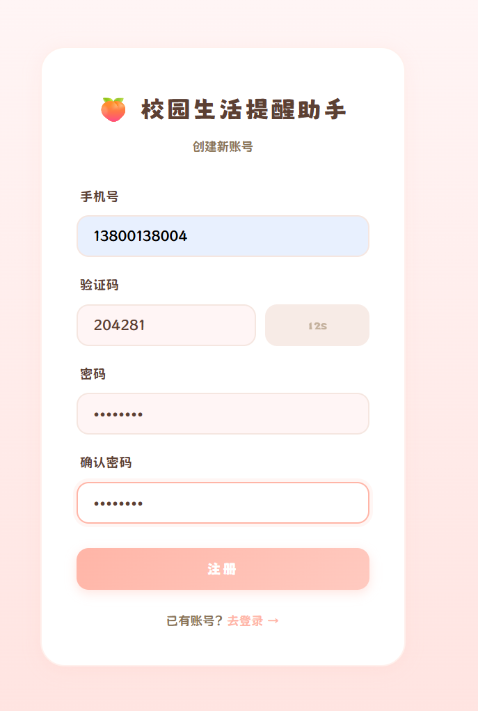
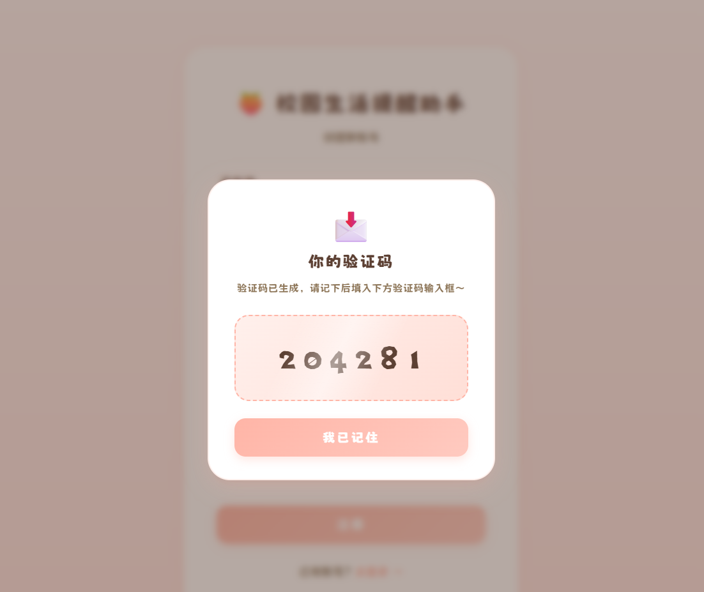

### 2.2 登录

1. 在登录页输入手机号与密码。
2. 点击 **登录**，登录成功后自动跳转到主页。
3. 登录状态保存在当前浏览器，下次访问无需重复输入。

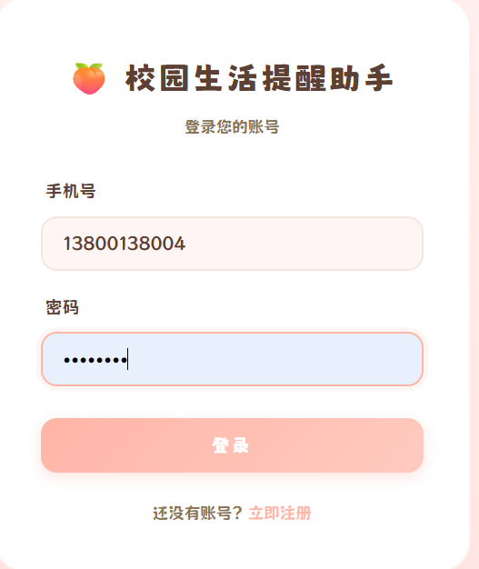

---

## 3. 对话页

主页默认展示对话页。在底部输入框输入内容后按回车发送，按 Shift+Enter 换行。例如：

- "明天下午 3 点开会"
- "等会提醒我喝水"
- "每周一早上 8 点去跑步"
- "明天天气怎么样？"

系统会根据输入自动判断意图，并调用相应能力（创建、查询、修改、取消提醒，或查询天气等）。

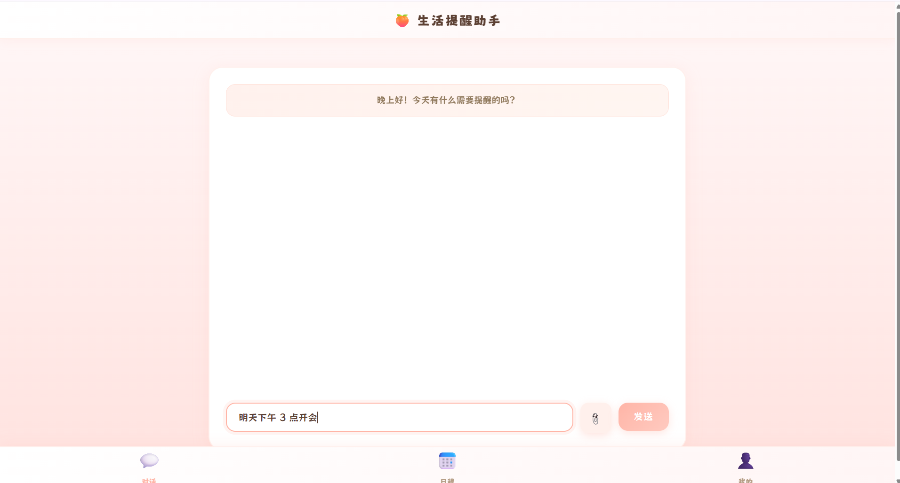

### 3.1 创建提醒

直接用一句话描述要提醒的事情，系统会识别时间与内容，并弹出确认卡片。

#### 3.1.1 定点提醒

明确指定时间点的提醒，例如：

> "明天下午 3 点开会"
> "周五上午 9 点交周报"
> "2026 年 8 月 10 日 14:00 去医院"

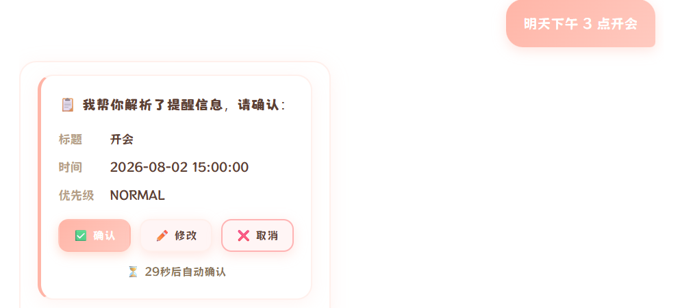

#### 3.1.2 模糊短时提醒

使用"等会"、"过一会"、"马上"等模糊时间词时，系统按当前时间提醒，不额外提前。你可以在确认卡片中点击"修改时间"改为具体时间。

> "等会提醒我喝水"
> "过一会儿提醒我去拿快递"

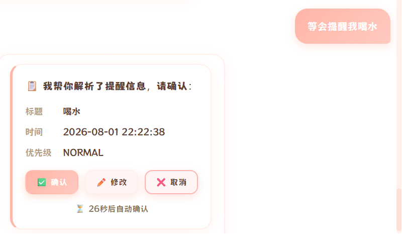

#### 3.1.3 周期提醒

需要按固定周期重复的提醒，例如：

> "每周一早上 8 点去跑步"
> "每天晚上 10 点睡觉"
> "每月 1 号交房租"

- 周期类型支持：每天、每周、每月。
- 周期提醒支持暂停、恢复与取消。

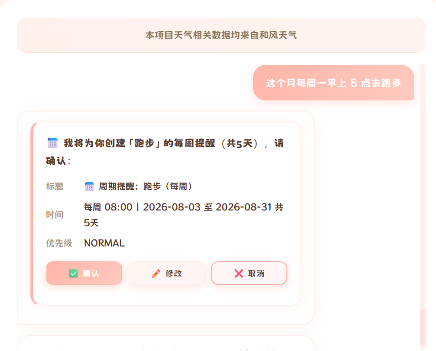

#### 3.1.4 一句话创建多项

一句话包含多个事项时，系统会生成一张多项事务卡片，例如：

> "明天 9 点交作业，10 点开会，下午 3 点取快递"

在卡片中逐项确认或取消；存在时间冲突的条目会单独提示，可选择覆盖或跳过。多项事务卡片不会自动超时，需要手动处理。

#### 3.1.5 长文本通知

可以直接粘贴整段通知，系统会提取时间、地点、事项内容与注意事项，生成一条提醒。通知中需要包含明确的时间信息。

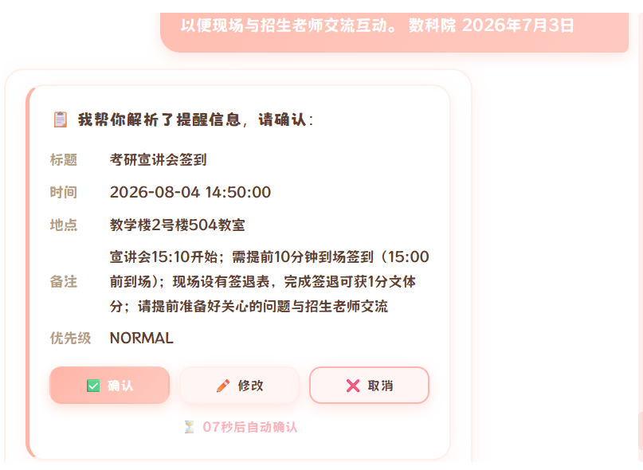

### 3.2 确认提醒

识别出提醒意图后，系统会弹出确认卡片：

- 普通卡片提供 **确认创建**、**修改时间**、**取消** 三个按钮。
- 存在时间冲突时，卡片额外提供 **覆盖** 按钮；覆盖会取消冲突提醒并创建新提醒。

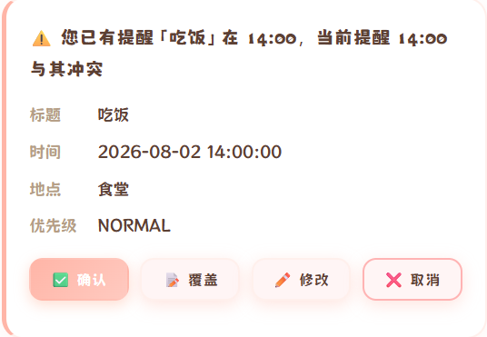

#### 30 秒自动确认

- 仅对 **单次且无时间冲突** 的提醒生效：30 秒内未操作，系统自动确认并提示"超时未操作，已自动确认"。
- 周期提醒、存在冲突的提醒、多项事务卡片 **不会** 自动确认，必须手动处理。

#### 到点提醒

提醒到点后会推送执行卡片，可选择：

- **已执行**：标记为已完成。
- **稍后提醒**：按设定间隔再次提醒。
- **取消**：取消本次执行。

### 3.3 修改提醒

修改已有提醒有两种方式：

1. **对话方式**：直接说明要修改的内容，例如：

> "把明天的开会提醒改成下午 4 点"

2. **确认卡片方式**：在创建过程中点击 **修改时间**，直接调整时间、地点、优先级等字段。

### 3.4 取消提醒

指定要取消的提醒，例如：

> "取消明天下午 3 点的开会提醒"

取消周期提醒时，可以取消整条周期模板（同时取消未执行的实例），也可以只取消某一天的实例。

### 3.5 查询提醒

直接用自然语言查询提醒，例如：

> "我明天有什么提醒？"
> "这周的提醒有哪些？"
> "下周三的安排"

系统会返回对应时间范围内的提醒列表。

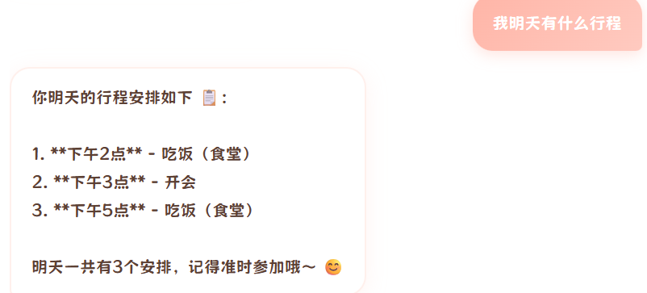

### 3.6 天气联动

支持以下天气查询：

| 查询类型 | 示例 |
| --- | --- |
| 实时天气 | "现在天气怎么样？" |
| 天气预报 | "明天会下雨吗？" |
| 空气质量 | "今天空气质量如何？" |
| 天气预警 | "有没有天气预警？" |

天气信息可与提醒结合，例如：

> "如果明天下雨，就提醒我带伞"

查询城市默认使用"我的"页设置的城市；也可以在对话中临时指定城市。

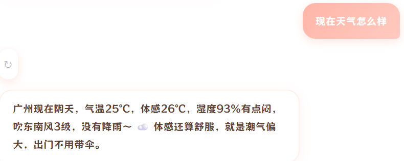

### 3.7 课表导入

#### 支持的文件格式

- Excel（.xlsx / .xls）
- PDF
- 图片（.jpg / .jpeg / .png / .gif / .webp）

#### 操作步骤

1. 点击输入框旁的附件按钮，选择课表文件上传。
2. 系统识别后弹出 **课表确认卡片**，显示识别到的课程、学期开始日期与总周数。
3. 如识别结果无误，点击 **确认生成** 批量创建上课提醒。
4. 如需调整节次时间，点击 **手动调整** 进入时间配置卡片：
   - **向下联动**（默认）：修改某节课时间后，后续节次顺延调整。
   - **向上联动**：修改某节课时间后，前面节次反向调整。
   - **互不影响**：只修改当前节次。
5. 确认时间配置后生成日程。

说明：

- 默认节次表为 10 节课。
- 识别有误时，可以在卡片中手动修改课程信息，或重新上传。

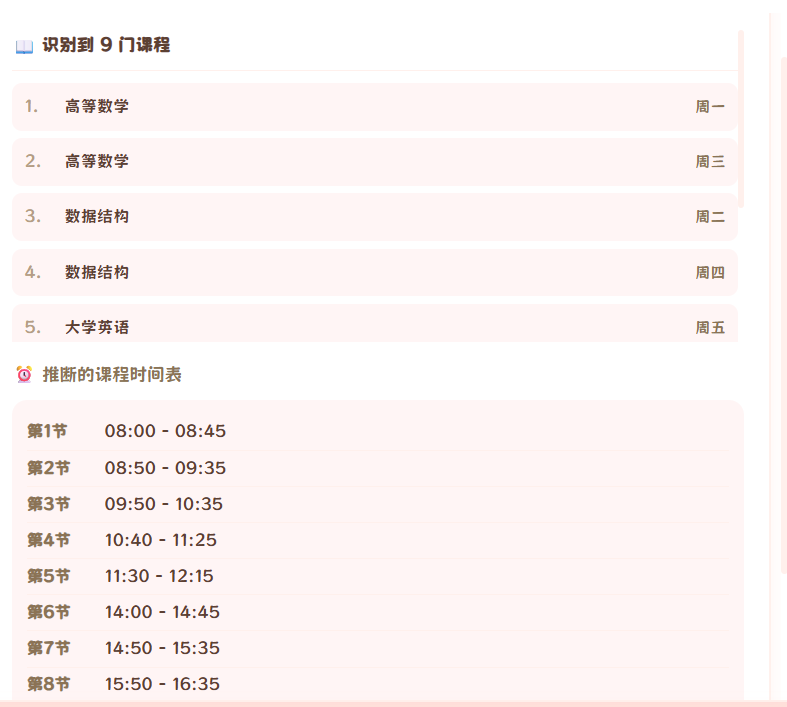
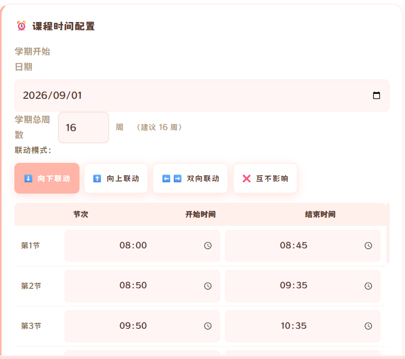

---

## 4. 日程页

点击底部导航的 **日程** 进入日程页，可按月或周查看提醒分布。

### 4.1 视图切换

- **月视图**：默认视图，展示整月提醒分布。
- **周视图**：展示一周内的提醒详情。
- 点击顶部日期标题可打开日期跳转器，快速切换到指定年月日。

### 4.2 红点标识

日期下方出现 **红点**，表示该日期有提醒。点击日期可查看当日提醒列表。

### 4.3 颜色标识

日程块使用不同颜色区分提醒类型与优先级：

| 颜色 | 含义 | 判定规则 |
| --- | --- | --- |
| 紫色 | 课程提醒 | 来源为课表导入，或标题含"课/上课/课程" |
| 橙色 | 高优先级 | 优先级为 HIGH |
| 粉色 | 普通提醒 | 优先级为 NORMAL |
| 绿色 | 低优先级 | 优先级为 LOW |

### 4.4 查看当日提醒

点击任意日期，下方会展开该日期的提醒列表，按时间顺序排列，显示标题、时间与优先级。

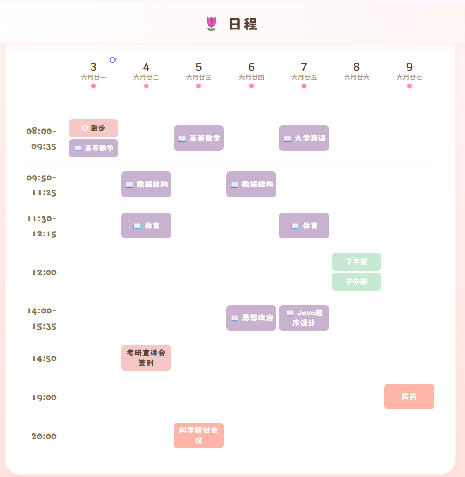

### 4.5 经期标记

启用经期管理后，日历会显示经期相关标记：

- 🌙 经期
- 🌸 非经期阶段（如排卵期）

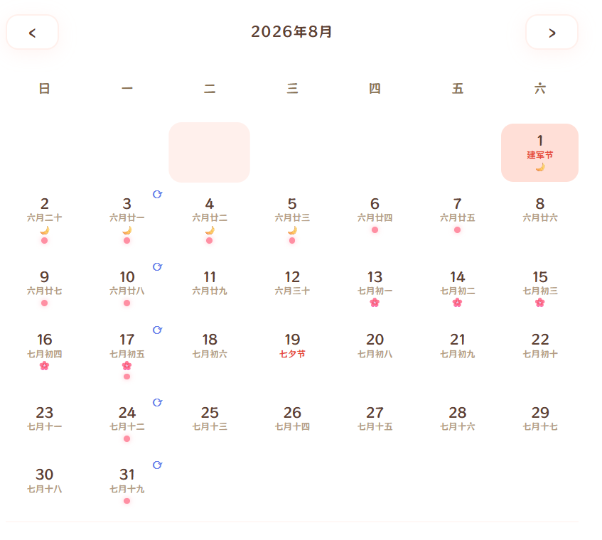

---

## 5. 我的页

点击底部导航的 **我的** 进入个人中心。

### 5.1 个人信息

可查看和修改：

- 头像与昵称
- 手机号
- 性别
- 默认城市
- 默认提前提醒分钟数
- 经期相关设置

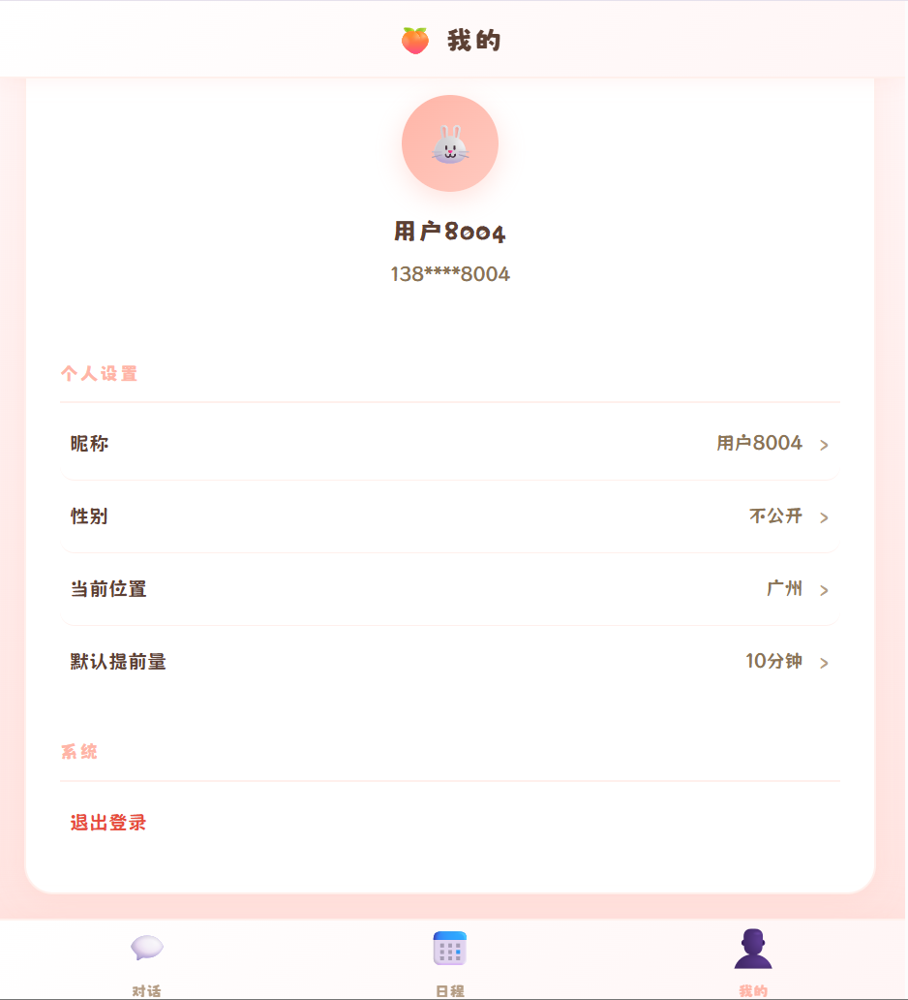

### 5.2 经期管理

经期管理仅对女性用户开放，设置项包括：

| 设置项 | 说明 |
| --- | --- |
| 周期天数 | 经期周期长度（默认 28 天） |
| 持续天数 | 经期持续天数（默认 5 天） |
| 上次经期开始日期 | 用于推算下次经期与排卵期 |
| 经期提醒开关 | 开启后在经期临近时提醒 |

说明：

- 系统每天 0:30 检查经期提醒；距下次经期 3 天内触发，默认提醒时间为下次经期前一天 20:30。
- 经期开始后，日历会标记经期与排卵期。
- 也可以通过对话查询：

> "我的经期状态怎么样？"
> "下次经期是什么时候？"

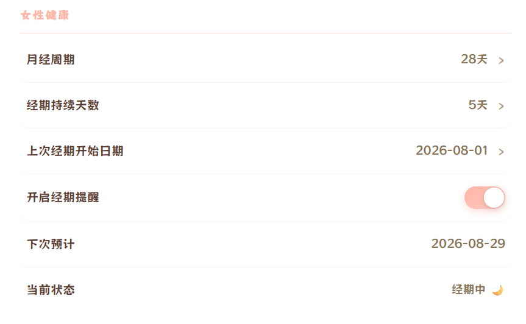

---

## 6. 助手记忆

点击底部导航的 **助手记忆** 进入记忆管理页。

- **查看**：按时间展示系统记录的个人信息、偏好、习惯等记忆。
- **搜索与筛选**：支持关键词搜索与按分类筛选。
- **备注**：记忆内容、分类与标题由系统生成，用户只能编辑备注。
- **删除**：支持单条删除与多选批量删除。
- **导出**：支持导出为 JSON 或 TXT 文件。

在对话中新增、修改或删除记忆后，记忆页会自动刷新。

---

## 7. 常见问题（FAQ）

### Q1：我说话后没有弹出确认卡片怎么办？

A：请检查：

- 网络是否正常。
- 是否已登录。
- 输入内容是否包含明确的时间或提醒意图。

### Q2：自动确认会不会误创建提醒？

A：只有 **单次且无时间冲突** 的提醒会在 30 秒未操作后自动创建，并给出提示。周期提醒、冲突提醒与多项事务不会自动确认。如不希望保留，可随后用"取消"指令撤销。

### Q3：周期提醒怎么删除整个周期？

A：直接说"取消 [周期提醒内容] 的所有提醒"，例如：

> "取消每周一跑步的所有提醒"

### Q4：课表识别错了怎么办？

A：在课表卡片中手动修改课程信息；如节次时间有误，点击"手动调整"修改时间配置。也可以重新上传文件。

### Q5：天气查询的城市怎么设置？

A：在"我的"页设置默认城市。也可以在对话中临时指定其他城市，例如"北京今天天气怎么样？"。

### Q6：经期提醒一直没收到，怎么排查？

A：请检查：

- "经期提醒开关"是否已开启。
- "上次经期开始日期"是否填写正确。
- 周期天数与持续天数是否合理。
- 系统每天 0:30 扫描经期提醒，刚设置完可能需要等到下一次扫描。

### Q7：日程上的颜色分别代表什么？

A：详见 [4.3 颜色标识](#43-颜色标识)：紫色为课程，橙色为高优先级，粉色为普通，绿色为低优先级。

### Q8：我能在手机上使用 RemindMe 吗？

A：可以。RemindMe 是网页应用，通过手机浏览器访问即可，建议使用 Chrome、Edge 。

---

> 如在使用过程中遇到本手册未涵盖的问题，请通过开发团队提供的反馈渠道进行反馈。
